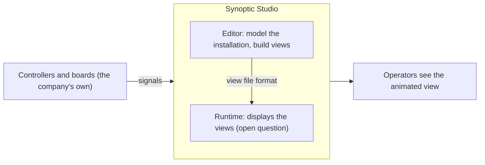
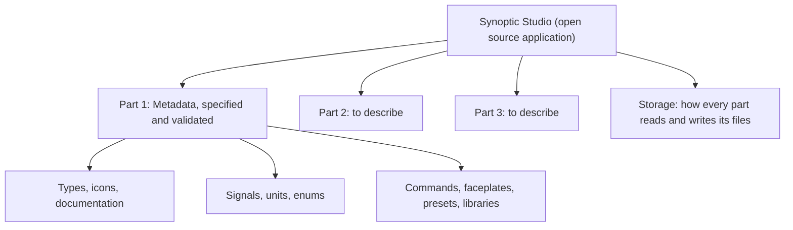

# synoptic-studio-spec

The specifications of **Synoptic Studio**, the open source desktop application to create and edit synoptics (animated process views of an industrial installation).

Status: the Metadata part is validated by the Product Owner (2026-11-11). The other parts are not written yet.

## What Synoptic Studio is

Synoptic Studio lets a company model its installation and build synoptics animated in JavaScript, without a SCADA. It replaces only the visual part of a SCADA: creating a view and displaying it. The company wires its own controllers to the displayed view.

It is also a tool to specify an installation and to help the people who simulate a whole circuit: the signals of a type define in advance what simulation models connect to.

Read the full story in the [introduction](overview/introduction.md).

## The three parts of the application

The Product Owner splits the application in three parts. Only the first one is specified so far.

## Where to read

| Folder | What it holds | Start with |
| --- | --- | --- |
| [`overview/`](overview/README.md) | The general presentation of the software. | [Introduction](overview/introduction.md) |
| [`metadata/`](metadata/README.md) | Part 1 of the application: the data and documentation a symbol can be attached to. | [Metadata overview](metadata/README.md) |
| [`storage/`](storage/README.md) | The folder the application points to, the generated files, and how conflicts between people are avoided. | [Files and conflicts](storage/files-and-conflicts.md) |

Metadata pages, in reading order:

1. What a type is: [Types](metadata/01-types.md), [Icons](metadata/02-icons.md), [Documentation](metadata/03-documentation.md).
2. The model side: [Signals](metadata/04-signals.md), [Units](metadata/05-units.md), [Enums](metadata/06-enums.md).
3. The front side: [Commands](metadata/07-commands.md), [Faceplates](metadata/08-faceplates.md), [Presets](metadata/09-presets.md).
4. How it is used: [Libraries](metadata/10-libraries.md), [Who changes what](metadata/11-who-changes-what.md).
5. What is left to decide: [Open questions](metadata/12-open-questions.md).

## What it does not contain

- No application code.
- Nothing beyond the open source application.

## Folder rule

Every folder created here has its own `README.md` that says what it contains.
