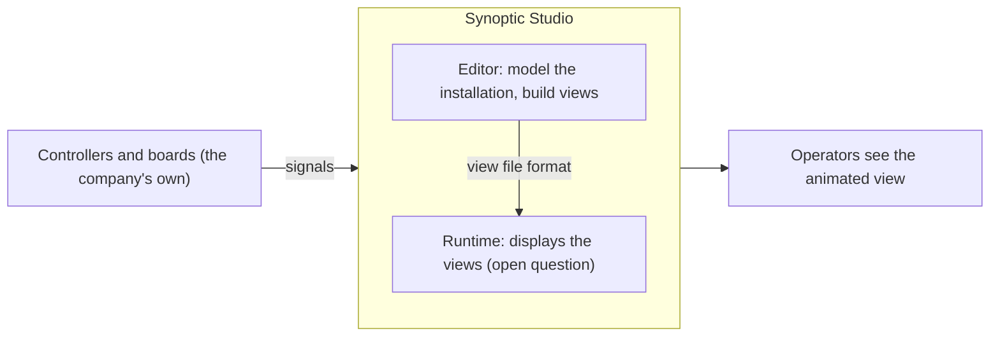
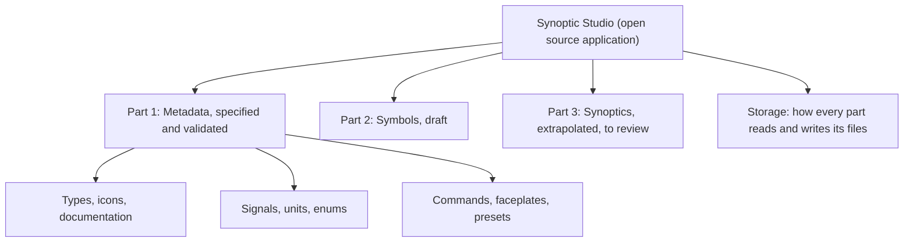

# synoptic-studio-spec

The specifications of **Synoptic Studio**, the open source desktop application to create and edit synoptics (animated process views of an industrial installation).

Status: the Metadata part is validated by the Product Owner (2026-11-11). The Symbols part is a draft (2026-11-11). The third part, Synoptics, is an extrapolation by the assistant (2026-11-20), to review.

## What Synoptic Studio is

Synoptic Studio lets a company model its installation and build synoptics animated in JavaScript, without a SCADA. It replaces only the visual part of a SCADA: creating a view and displaying it. The company wires its own controllers to the displayed view.

It is also a tool to specify an installation and to help the people who simulate a whole circuit: the signals of a type define in advance what simulation models connect to.

Read the full story in the [introduction](overview/introduction.md).

## The three parts of the application

The Product Owner splits the application in three parts. The first is validated, the second is a draft, the third is an extrapolation to review.

## Where to read

| Folder | What it holds | Start with |
| --- | --- | --- |
| [`overview/`](overview/README.md) | The general presentation of the software, and the glossary of the whole specification. | [Introduction](overview/introduction.md), then the [Glossary](overview/glossary.md) |
| [`metadata/`](metadata/README.md) | Part 1 of the application: the data and documentation a symbol can be attached to. | [Metadata overview](metadata/README.md) |
| [`symbols/`](symbols/README.md) | Part 2 of the application: symbol libraries, drawing, animation, interactions. Draft. | [Symbols overview](symbols/README.md) |
| [`synoptics/`](synoptics/README.md) | Part 3 of the application: placing symbols, pipes, identity of each placed symbol, faults, test, outputs. Extrapolated by the assistant, to review. | [Synoptics overview](synoptics/README.md) |
| [`storage/`](storage/README.md) | The folder the application points to, the generated files, and how conflicts between people are avoided. | [Files and conflicts](storage/files-and-conflicts.md) |
| [`controls/`](controls/README.md) | The controls shared by every screen: one number field, one text field, with the same behaviour everywhere. Draft. | [Number and text fields](controls/number-and-text-fields.md) |
| [`screens/`](screens/README.md) | The inventory of the screens and menus: for each screen, a map, every button, field and list with its status, and what is missing. | [Map of the screens](screens/README.md) |
| [`design-system/`](design-system/README.md) | The design system before it is drawn: principles, tokens, icons, components and their states, the pages of the Figma file. First draft. | [Principles](design-system/01-principles.md) |

Metadata is being written again, one file per theme (2026-11-19): the first is the [Data model](metadata/data-model.md), its schema to validate. Until each theme is done, the earlier pages are gathered in the [whole draft](metadata/draft.md), in this reading order:

1. What a type is: [Types](metadata/draft.md#types), [Icons](metadata/draft.md#type-icons), [Documentation](metadata/draft.md#type-documentation).
2. The model side: [Signals](metadata/draft.md#signals), [Units](metadata/draft.md#units), [Enums](metadata/draft.md#enums).
3. The front side: [Commands](metadata/draft.md#commands), [Presets and their faceplate](metadata/draft.md#presets-and-their-faceplate).
4. How it is used: [Who changes what](metadata/draft.md#who-changes-what-and-where).
5. What is left to decide: [Open questions](metadata/draft.md#metadata-open-questions).

## What it does not contain

- No application code.
- Nothing beyond the open source application.

## Folder rule

Every folder created here has its own `README.md` that says what it contains.
