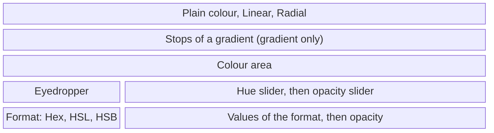

# Colour field

> [Home](../README.md) › [Controls](README.md) › Colour field

Status: draft. Asked by the Product Owner on 2026-11-24 ("la même façon de faire que Figma"), popup completed on 2026-11-25. Not validated.

Every colour of the application is set with the same field, as Figma does: one line, a swatch and two inputs.

## Rules

- **One line**: a **swatch**, then **two inputs in one field**, split by a thin **separator**: the **colour** (hex, six digits, no `#`) and the **opacity** (in %). They stay two inputs: each is typed on its own (Product Owner, 2026-11-24).
- **No "Kind" line** in the panel: the kind of fill is chosen in the popup of the swatch.
- A gradient shows in the swatch; the colour input then reads "Linear" or "Radial", and the colours are changed in the popup (assistant's proposal, as Figma).
- **Removing and adding**: a **−** at the end of the line removes it; a **+** on the right of the title of the section adds one. There is no kind "None" (Product Owner, 2026-11-24: "comme Figma"). Where several are allowed (the fills of a shape, see [Fill and border](../symbols/04-drawing-mode/fill-and-border.md#several-fills)), the + stays shown.

### The paint popup

A click on the swatch opens the popup, beside the panel. From top to bottom:

| Part | What it holds | Status |
| --- | --- | --- |
| Kind | Tabs: Plain colour, Linear, Radial (the kinds of [Fill and border](../symbols/04-drawing-mode/fill-and-border.md#what-a-fill-can-be)). | Decided (2026-11-25) |
| Stops | For a gradient only: a bar with its colour stops; a click on the bar adds a stop, a stop dragged away removes it; the selected stop is the colour edited below; then its angle (linear) or its centre (radial). | Proposed |
| Colour area | Saturation and brightness of the hue. | Decided |
| Eyedropper | An icon button on the left of the sliders: it picks a colour on the drawing of the editor (not on the whole screen: the `EyeDropper` interface of browsers is experimental). | Decided (2026-11-25) |
| Hue slider | The hue, as now. | Decided (2026-11-25) |
| Opacity slider | The opacity (the A of RGBA), on a checkerboard. | Decided (2026-11-25) |
| Format and values | A small select, then the values of that format: **Hex** (one input and the opacity), **HSL** (H, S, L and the opacity), **HSB** (H, S, B and the opacity). Hex by default; the select keeps the last format used. | Decided (2026-11-25: "en HSB et en HSL") |

## Example

| Line | Meaning |
| --- | --- |
| `■ D9DBE0 │ 100 %` | Plain light grey, opaque. |
| `■ 40454D │ 0 %` | A transparent colour: a gap in a [segment list](segment-list.md). |
| `▦ Linear │ 100 %` | A linear gradient; its stops are in the popup. |
| Popup in HSL: `210  8  86 │ 100 %` | The same light grey written in HSL. |

## Where it is used

| Screen | Control |
| --- | --- |
| [SY-04](../screens/symbols.md#sy-04--drawing-mode) · a shape | Each fill (SY-04.4), each segment of the border (SY-04.9) |
| [SY-04](../screens/symbols.md#sy-04--drawing-mode) · a text | Text colour, text border (SY-04.28, SY-04.29) |
| [SY-12](../screens/symbols.md#sy-12--enums-of-a-symbol-lib) | Value of a colour column (SY-12.7) |
| [PI-02](../screens/pipes.md#pi-02--pipe-style) | Each segment of the body fill and of the border fill |

## Open questions

- Pattern and image: Figma offers them in the same popup; pattern is open for the fills of a shape (see [Fill and border](../symbols/04-drawing-mode/fill-and-border.md#what-a-fill-can-be)), image is not asked.
- RGB as a fourth format: said useless, then compared with HSB, on 2026-11-25; not offered until said.
- A gradient for one segment of a border: allowed, or plain colours only in a segment?
