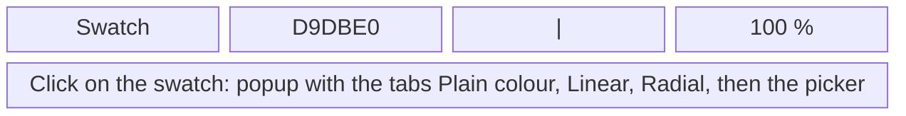

# Colour field

> [Home](../README.md) › [Controls](README.md) › Colour field

Status: draft. Asked by the Product Owner on 2026-11-24 ("la même façon de faire que Figma"). Not validated.

Every colour of the application is set with the same field, as Figma does: one line, a swatch and two inputs.

## Rules

- **One line**: a **swatch**, then **two inputs in one field**, split by a thin **separator**: the **colour** (hex, six digits, no `#`) and the **opacity** (in %). They stay two inputs: each is typed on its own (Product Owner, 2026-11-24).
- **No "Kind" line** in the panel: the kind of fill is chosen in the popup of the swatch.
- **A click on the swatch opens the paint popup**, beside the panel:
  - at the top, the **kind**, as tabs: Plain colour, Linear gradient, Radial gradient (the kinds of [Fill and border](../symbols/04-drawing-mode/fill-and-border.md#what-a-fill-can-be));
  - under it, the picker of that kind: a colour area and a hue bar, then the same hex and opacity inputs; for a gradient, its stops, and its angle or its centre.
- A gradient shows in the swatch; the colour input then reads "Linear" or "Radial", and the colours are changed in the popup (assistant's proposal, as Figma).
- **Removing and adding**: a **−** at the end of the line removes the fill; a **+** on the right of the title of the section adds one back, shown only when there is none (assistant's proposal, as Figma; it replaces the kind "None").

## Example

| Line | Meaning |
| --- | --- |
| `■ D9DBE0 │ 100 %` | Plain light grey, opaque. |
| `■ 40454D │ 0 %` | A transparent colour: a gap in a [segment list](segment-list.md). |
| `▦ Linear │ 100 %` | A linear gradient; its stops are in the popup. |

## Where it is used

| Screen | Control |
| --- | --- |
| [SY-04](../screens/symbols.md#sy-04--drawing-mode) · a shape | Fill (SY-04.4), each segment of the border (SY-04.9) |
| [SY-04](../screens/symbols.md#sy-04--drawing-mode) · a text | Text colour, background colour, text border (SY-04.28, SY-04.29) |
| [SY-12](../screens/symbols.md#sy-12--enums-of-a-symbol-lib) | Value of a colour column (SY-12.7) |
| [PI-02](../screens/pipes.md#pi-02--pipe-style) | Each segment of the body fill and of the border fill |

## Open questions

- Pattern and image: Figma offers them in the same popup; are they kinds of fill of Synoptic Studio?
- A gradient for one segment of a border: allowed, or plain colours only in a segment?
- In the picker: HSL besides hex, and an eyedropper of the editor itself (proposed by the research, see [Fill and border](../symbols/04-drawing-mode/fill-and-border.md#colours)).
