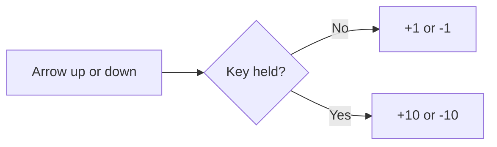

# Number and text fields

> [Home](../README.md) › [Controls](README.md) › Number and text fields

Status: draft. Not validated.

## Rules

### One component each

- Every number field of the application is the same component, with the same behaviour. The same holds for every text field.
- They are components of the design system, written once and used by every part.

### Number field

- The up and down arrows of the keyboard add or remove **1**.
- With a modifier key held, they add or remove **10**.
- The key: Shift, "or the same key" as the [precise move](../symbols/03-editor/precise-move.md), which does the opposite with the mouse (slower instead of faster). Proposal of the assistant: **Shift**, the usual key for a step of 10 in drawing software; the precise move then takes another key.
- The value stays within the bounds of the field, when it has some (assumption of the assistant).
- **No "px"**: a length is always in pixels, so the field never writes the unit (Product Owner, 2026-11-24). Another unit is written when it says something: % for an opacity, ° for an angle.

### Text field

- One component for every text field. Its behaviour beyond that is not described yet.

## Example

| Field | Value | Key | Result |
| --- | --- | --- | --- |
| Border size | 2 | Arrow up | 3 |
| Border size | 2 | Shift + arrow up | 12 |
| Corner radius | 15 | Arrow down | 14 |

## Open questions

- Which key for the step of 10 (proposal: Shift), and is it the same as the precise move?
- The step of a field with decimals (a real number, an angle): 1, or the smallest decimal shown?
- Does dragging on the label of a number field change the value, as in Figma?
- What the text field does beyond being one shared component.
