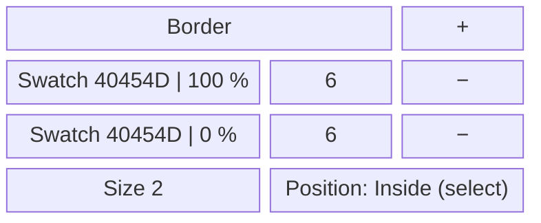

# Segment list

> [Home](../README.md) › [Controls](README.md) › Segment list

Status: draft. Asked by the Product Owner on 2026-11-24 for the borders of the shapes; applied to the fills of the pipes, which follow the same rule of [dash sequences](../symbols/pipes/pipe-styles.md#dash-sequences). Not validated.

How a border, or a fill made of dashes, is set: a list of lines, each a segment of colour with its length. It replaces the toggle of the border, the radio "colour or dash sequence" and the separate editor of dash sequences.

## Rules

- The section has a **title** (Border, Body fill, Border fill) with a **small +** on its right, as every list ([layout rules](../screens/README.md#a-title-and-a-small--on-its-right)): it adds a line.
- Each **line** is one segment: a [colour field](colour-field.md) (swatch, colour │ opacity), then its **length**, then a **−** that removes the line.
- **One line**: a plain border, of that colour.
- **Two lines or more**: dashes. The segments follow each other along the border, in the order of the list, and repeat. A **gap** is a segment whose opacity is **0 %**. Example: `40454D 100 % 6`, `40454D 0 % 6` gives dashes of 6 and gaps of 6.
- **No line**: no border. There is no toggle "Border" (Product Owner, 2026-11-24: "comme Figma").
- **Under the list**: the **size** of the border (a number field, in pixels, no unit) and its **position**, a **segmented control**: Inside, Middle, Outside, in one click (Product Owner, 2026-11-26; see [the layout rule](../screens/README.md#a-segmented-control-for-two-to-four-short-options)). The size field is narrow, the three positions take the rest of the line.
- Every change is applied at once, as everywhere.

## Example

| Lines | Result |
| --- | --- |
| `40454D 100 % 6` | A plain dark border. |
| `40454D 100 % 6`, `40454D 0 % 6` | Classic dashes. |
| `D32F2F 100 % 6`, `1C1C1E 100 % 6` | Red and black stripes. |
| none | No border. |

## Where it is used

| Screen | Control |
| --- | --- |
| [SY-04](../screens/symbols.md#sy-04--drawing-mode) · a shape | Border (SY-04.5 to SY-04.9) |
| [PI-02](../screens/pipes.md#pi-02--pipe-style) | Body fill, border fill ([PI-04](../screens/pipes.md#pi-04--segment-list)) |

## Open questions

- The order of the lines: changed with a handle, as other ordered lists?
- A pipe style with no line in its body fill: allowed (an invisible body), or one line at least?
