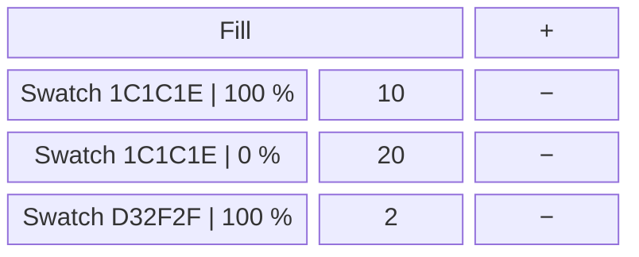

# Segment list

> [Home](../README.md) › [Controls](README.md) › Segment list

Status: draft. Asked by the Product Owner on 2026-11-24 for the borders of the shapes and the fills of the pipes; since 2026-11-26 the body fill of a pipe only: no border has dashes (decision 0109). Not validated.

How the body of a pipe is filled with dashes: a list of lines, each a segment of colour with its length. It replaces the radio "colour or dash sequence" and the separate editor of dash sequences.

## Rules

- The section has a **title** (Fill, in the section Body of a pipe style) with a **small +** on its right, as every list ([layout rules](../screens/README.md#a-title-and-a-small--on-its-right)): it adds a line.
- Each **line** is one segment: a [colour field](colour-field.md) (swatch, colour │ opacity), then its **length**, then a **−** that removes the line.
- **One line**: a plain body, of that colour.
- **Two lines or more**: dashes. The segments follow each other along the pipe, in the order of the list, and repeat. A **gap** is a segment whose opacity is **0 %**. Example: `40454D 100 % 6`, `40454D 0 % 6` gives dashes of 6 and gaps of 6.
- **No line**: see the open questions.
- **No header** of columns above the lines (Product Owner, 2026-11-26): the length field holds a small icon of a length instead.
- Every change is applied at once, as everywhere.
- A **border** (of a shape, a text or a pipe) is not a segment list: its colours stack, without length (see [Fill and border](../symbols/04-drawing-mode/fill-and-border.md#border-options)).

## Example

| Lines | Result |
| --- | --- |
| `40454D 100 % 6` | A plain dark body. |
| `40454D 100 % 6`, `40454D 0 % 6` | Classic dashes. |
| `D32F2F 100 % 6`, `1C1C1E 100 % 6` | Red and black stripes. |

## Where it is used

| Screen | Control |
| --- | --- |
| [PI-02](../screens/pipes.md#pi-02--pipe-style) | Body fill ([PI-04](../screens/pipes.md#pi-04--segment-list)) |

## Open questions

- The order of the lines: changed with a handle, as other ordered lists?
- A pipe style with no line in its body fill: allowed (an invisible body), or one line at least?
