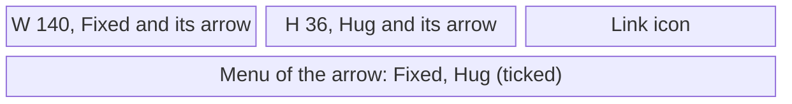

# Size fields

> [Home](../README.md) › [Controls](README.md) › Size fields

Status: draft. Asked by the Product Owner on 2026-11-24 ("comme Figma"); the form below is the assistant's choice, which the Product Owner left open ("à toi de trouver le meilleur truc en UX"). Not validated.

The width and the height of an object, set in the right-hand panel, as Figma does.

## Rules

- **W** and **H** are two [number fields](number-and-text-fields.md) **on one line**, side by side, each with its letter inside, on the left.
- Each shows its value **in pixels, without unit**: a size is always in pixels (Product Owner, 2026-11-24).
- **The value is always shown**, whatever the mode: the user always sees the size of the object, and types in the same field to change it. The field is read and written at once (Product Owner, 2026-11-24).

### Fixed or Hug

- An object that can wrap its content (a [group](../symbols/04-drawing-mode/group.md)) has a **mode** for each field: **Fixed** or **Hug**.
- The mode is written inside the field, on its right, with a **small arrow**: `140  Fixed ▾`. A click on it opens a **small menu**: Fixed, Hug; the current one is ticked.
- **Hug**: the object takes the size of its content; the field shows that size, computed.
- **Fixed**: the object has the size typed by the user.
- Typing a value in a field in Hug turns it to Fixed, with that value, as in Figma (assistant's proposal).
- An object that cannot wrap a content (a rectangle, an ellipse, a polygon) has no mode: its fields are always fixed, with no arrow.

### Width and height linked

- A **link** icon button, on the right of the line, keeps the ratio of the width and the height: changing one changes the other. It is the visible equivalent of the key that draws a square or a circle (assistant's proposal: it replaces the toggle "Link width and height" of [SY-04.15](../screens/symbols.md#panel-of-a-shape-options-by-tool)).

## Example

| Object | Field | Mode | Shown | The user types 60 |
| --- | --- | --- | --- | --- |
| Group Body | W | Fixed | `140 Fixed ▾` | 60, still Fixed |
| Group Body | H | Hug | `36 Hug ▾` (the height of its content) | 60, turned to Fixed |
| Rectangle Outlet | W | — | `72` | 60 |

## Where it is used

| Screen | Control |
| --- | --- |
| [SY-04](../screens/symbols.md#sy-04--drawing-mode) · Group | Width and height, Fixed or Hug (SY-04.19) |
| [SY-04](../screens/symbols.md#sy-04--drawing-mode) · Rectangle, ellipse, polygon | Width and height, fixed, with the link (SY-04.36, SY-04.15) |

## Open questions

- A group whose size is given by a signal of the type, picked with an icon inside the field, as the speed of a pipe ([PI-01.10](../screens/pipes.md#pi-01--base-pipe-style)): wanted? The Product Owner mentioned "la sélection par variable" without settling it.
- X and Y of the selected object: on the same kind of line, above W and H?
