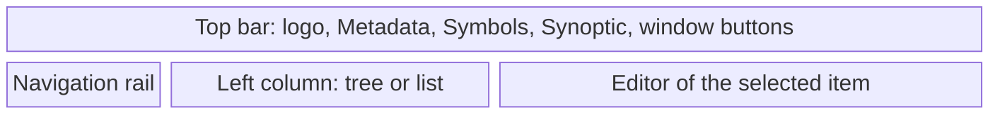

# Principles

> [Home](../README.md) › [Design system](README.md) › Principles

Status: first draft, from the Product Owner's brief of 2026-11-22. Not validated.

## Rules

### For everyone, from 20 to 77

- The application is for people from 20 to 77 years old (Product Owner, 2026-11-22: "c'est une image"): everyone must be able to use it, without good eyesight or a precise hand.
- It looks a little like Figma, without looking like Figma.

### Dense, but larger than Figma

- The screens are dense: much information at once, as an editor needs.
- Every control is **larger than Figma's**: buttons, fields, menus, text. In Figma's current interface, menu items and inputs are 24 px high and the text is very small; the old interface had 32 px menu items (users of the Figma forum, December 2024).
- The sizes are in [Foundations](02-foundations.md#sizes): a control is 32 px high by default, its text 14 px (proposed).
- A click target is never smaller than 24 × 24 px, the minimum of WCAG 2.2 (criterion 2.5.8); the Product Owner's rule asks for more, so the controls take 32 px.

### One theme

- One theme only, `sand`, built on the colours of the old **Warm Sand** theme (light) (Product Owner, 2026-11-22: "c'est le logiciel, il est open source. Pour l'instant, il y a qu'un truc, point barre"; "c'est warm sand").
- Warm Sand is a base, not a list to copy: only the colours the components need are kept.
- The colours are still variables, so a theme can be added later as a mode without changing a component.

### Screens in 16:9, at least 1600 × 900

- Every screen is drawn in 16:9.
- The smallest window the application is designed for is **1600 × 900** (Product Owner, 2026-11-22). The screens of the Metadata page are drawn at that size.
- Below it, nothing is promised: the application is not designed for a phone or a tablet. The screens are an editor and data tables, which need a two-dimensional layout: WCAG 2.2 exempts them from reflow at 320 px wide (criterion 1.4.10). See [Skill rules R4](skill-rules.md#r4--screens-in-169-at-least-1600--900).

### Components with their states, never empty shells

- Every component is drawn whole, with its variants and its states (default, hover, pressed, focus, disabled, and the ones it needs: selected, error, read only...).
- No placeholder component, no hollow frame waiting to be filled.

## Where it is used

| Where | What it changes |
| --- | --- |
| [Foundations](02-foundations.md) | The sizes, the type scale and the colours follow these rules. |
| [Components](03-components.md) | Every component has its states and its sizes. |
| [Screens of Metadata](../screens/metadata.md) | Drawn at 1600 × 900. |
