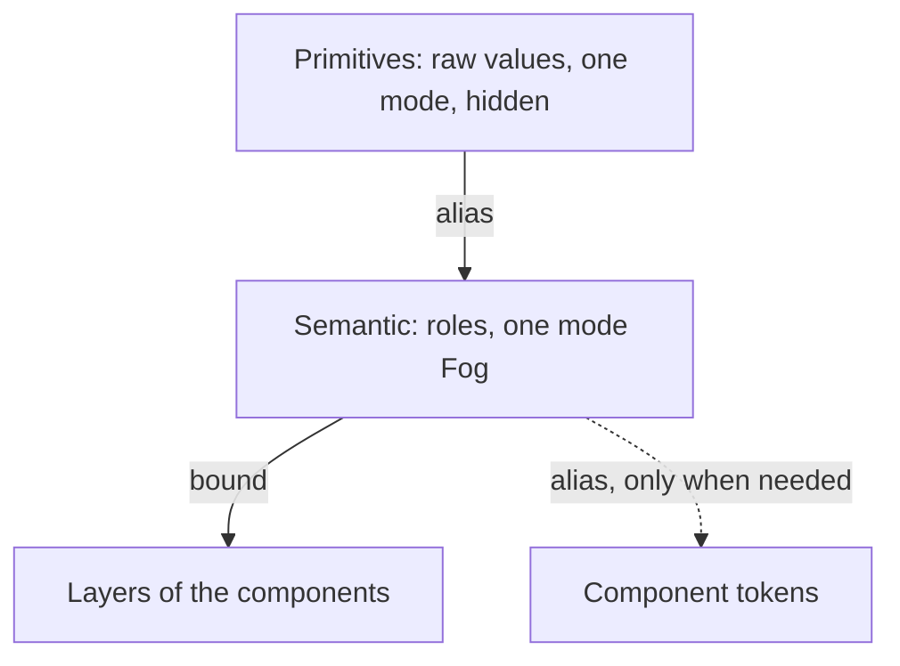

# Foundations

> [Home](../README.md) › [Design system](README.md) › Foundations

Status: first draft, written by the assistant on 2026-11-22. Every value here is **proposed**, to review on screen in Figma. The colour values are not written yet: they come from the Neutral Fog theme of the old design system, read in Figma.

## How the tokens are layered

Two layers to start with; a third only when a component must differ from the shared roles.

| Collection | Holds | Modes |
| --- | --- | --- |
| `primitives` | The colour scale taken from Neutral Fog, the spacing and size scales. Never bound to a layer. | One |
| `semantic` | The roles below, each an alias of a primitive. | One: `fog` |

Names are those of the code (`text-primary` in Figma is `--ss-text-primary` in CSS); the same name in both.

## Colours

The roles the components of the specs need. Their values: the nearest colour of Neutral Fog.

| Role | What it colours |
| --- | --- |
| `background` | The window behind everything. |
| `layer-01` | Panels, columns, the top bar, the rail. |
| `layer-02` | A surface on a panel: a field, a table header. |
| `layer-hover` | A line, a button or an item under the mouse. |
| `layer-selected` | The selected line, item or part. |
| `border-subtle` | Separators, table lines. |
| `border-strong` | The border of a field, a checkbox, a radio. |
| `text-primary` | Text, values. |
| `text-secondary` | Labels, headers, inherited lines. |
| `text-placeholder` | The hint in an empty field. |
| `text-disabled` | Text of a disabled control. |
| `text-on-accent` | Text on an accent button. |
| `icon-primary` | Icons of the controls. |
| `icon-secondary` | Quiet icons: the + on hover, a handle. |
| `accent` | The main action, the checked state, the selected part. |
| `accent-hover` | The accent under the mouse. |
| `focus` | The focus ring. |
| `danger` | A delete in a warning, an error. |
| `warning` | A warning that does not block (a required designation left empty). |
| `success` | A check that passed. |
| `signal-input` | The background of a line of an input signal ([MD-04.5b](../screens/metadata.md#md-04--signals)). |
| `signal-output` | The background of a line of an output signal. |
| `overlay` | The veil behind a dialog. |

Every pair of text and background passes 4.5:1, every border and icon of a control 3:1 against its neighbour (WCAG 2.2 AA); disabled text is exempt.

## Typography

One family for the whole interface, one for code (the Markdown mode, formulas). The families: see [Open questions](open-questions.md).

| Style | Size / line | Weight | Used for |
| --- | --- | --- | --- |
| `caption` | 12 / 16 | Regular | Help under a field, a table header. |
| `body` | 14 / 20 | Regular | Every control, every value, every line. |
| `body-strong` | 14 / 20 | Semibold | The title of a list, a selected part. |
| `heading` | 16 / 24 | Semibold | The title of a column or a dialog. |
| `title` | 20 / 28 | Semibold | Rare: the name of an empty screen. |
| `code` | 13 / 20 | Regular | Markdown, formulas. |

For comparison, Figma's interface puts its controls in 24 px high lines, with a much smaller text (see [Principles](01-principles.md#dense-but-larger-than-figma)).

## Spacing

A scale on a 4 px base.

| Token | Value |
| --- | --- |
| `spacing-01` | 2 |
| `spacing-02` | 4 |
| `spacing-03` | 8 |
| `spacing-04` | 12 |
| `spacing-05` | 16 |
| `spacing-06` | 24 |
| `spacing-07` | 32 |
| `spacing-08` | 48 |

Usual gaps: 8 between two controls, 12 between a label and its control, 16 from the edge of a panel.

## Sizes

| Token | Value | Used for |
| --- | --- | --- |
| `size-control-sm` | 28 | A control inside a table cell. |
| `size-control-md` | 32 | Every control by default: button, field, select, menu item. |
| `size-control-lg` | 40 | A main action in a dialog. |
| `size-row` | 36 | A line of a table, a list, the tree. |
| `size-icon-sm` | 16 | An icon in a control of 28 or 32. |
| `size-icon-md` | 20 | An icon of the rail, of the top bar, of a 40 control. |
| `size-top-bar` | 40 | Height of the top bar. |
| `size-rail` | 48 | Width of the navigation rail. |
| `size-left-column` | 320 | Width of the left column (tree, lists) at 1600 × 900. |

## Radii, borders, shadows

| Token | Value | Used for |
| --- | --- | --- |
| `radius-sm` | 4 | Controls: button, field, checkbox, menu item. |
| `radius-md` | 8 | Panels, menus, dialogs. |
| `radius-full` | 999 | Toggle, round badges. |
| `border-width` | 1 | Every border. |
| `focus-width` | 2 | The focus ring, outside the control. |
| `shadow-raised` | effect style | Menus, the floating bars of the symbol editor. |
| `shadow-overlay` | effect style | Dialogs. |

## Where it is used

| Where | What it uses |
| --- | --- |
| [Components](04-components.md) | Every value of every component is one of these tokens. |
| Repository `synoptic-studio-design-system` | The same tokens, exported as W3C Design Tokens (DTCG) JSON. |
