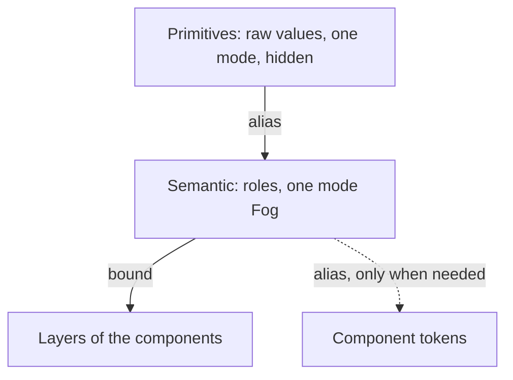

# Foundations

> [Home](../README.md) › [Design system](README.md) › Foundations

Status: first draft, written by the assistant on 2026-11-22, drawn on the page Foundations of the Figma file the same day. Every value here is **proposed**, to review on screen. The colours are those of the Warm Sand theme of the old design system, read in Figma.

## How the tokens are layered

Two layers to start with; a third only when a component must differ from the shared roles.

| Collection | Holds | Modes |
| --- | --- | --- |
| `primitives` | The colour scale taken from Warm Sand (`sand/05` to `sand/90`, `white`, `black`, the accents), one number scale (`scale/1` to `scale/999`). Never bound to a layer. | One: `value` |
| `semantic` | The roles below, each an alias of a primitive. | One: `sand` |

Names are those of the code (`text-primary` in Figma is `--ss-text-primary` in CSS); the same name in both.

## Colours

The roles the components of the specs need, with their value in the theme `sand`. "Warm Sand" gives the token of the old theme the value comes from; "new" marks a value Warm Sand does not have.

| Role | What it colours | Value | Warm Sand |
| --- | --- | --- | --- |
| `background` | The window behind everything. | `#dfd9c9` | `surface/canvas` |
| `layer-01` | Panels, columns, the top bar, the rail. | `#e9e2d3` | `surface/base` |
| `layer-02` | A surface on a panel: a field, a table header. | `#f3ecdd` | `surface/sunken` |
| `layer-hover` | A line, a button or an item under the mouse. | `#e1dacb` | `interact/hover` |
| `layer-pressed` | A button or an item while the mouse button is down. | `#d9d2c3` | `interact/pressed` |
| `layer-selected` | The selected line, item or part. | `#d6cded` | `interact/selected` |
| `layer-inverse` | A tooltip. | `#181612` | `content/primary` |
| `border-subtle` | Separators, table lines. | `#d4cdbe` | `border/subtle` |
| `border-strong` | The border of a field, a checkbox, a radio. | `#797773` | `border/strong` |
| `text-primary` | Text, values. | `#181612` | `content/primary` |
| `text-secondary` | Labels, headers, inherited lines. | `#4a4743` | `content/secondary` |
| `text-placeholder` | The hint in an empty field. | `#63605b` | new |
| `text-disabled` | Text of a disabled control. | `#8b8985` | `content/disabled` |
| `text-on-accent` | Text on an accent or danger button. | `#ffffff` | `content/on-accent` |
| `text-inverse` | Text of a tooltip. | `#ffffff` | new |
| `icon-primary` | Icons of the controls. | `#181612` | `content/primary` |
| `icon-secondary` | Quiet icons: the + on hover, a handle. | `#4a4743` | `content/secondary` |
| `accent` | The main action, the checked state, the selected part. | `#6c539c` | `accent/default` |
| `accent-hover` | The accent under the mouse. | `#5b468b` | `accent/hover` |
| `accent-pressed` | The accent while the mouse button is down. | `#4c3c72` | `accent/text` |
| `focus` | The outer, dark line of the focus. | `#4c3c72` | `accent/text` |
| `focus-inset` | The inner, light line of the focus. | `#ffffff` | new |
| `danger` | A delete in a warning, an error. | `#8c4a46` | `danger/default` |
| `danger-hover` | A danger button under the mouse or pressed. | `#6b3633` | `danger/hover` |
| `warning` | A warning that does not block (a required designation left empty). | `#7c5619` | `warning/default` |
| `success` | A check that passed. | `#30693f` | `success/default` |
| `signal-input` | The background of a line of an input signal ([MD-04.5b](../screens/metadata.md#md-04--signals)). | `#dde3ec` | new |
| `signal-output` | The background of a line of an output signal. | `#dbe6d6` | new |
| `overlay` | The veil behind a dialog. | `#000000` at 60 % | `overlay/scrim` |

Every pair of text and background passes 4.5:1, every border and icon of a control 3:1 against its neighbour (WCAG 2.2 AA); disabled text is exempt.

## Typography

One family for the whole interface, **Inter**, one for code (the Markdown mode, formulas), **JetBrains Mono**: both free (SIL Open Font License), proposed. See [Open questions](open-questions.md).

| Style | Size / line | Weight | Used for |
| --- | --- | --- | --- |
| `caption` | 12 / 16 | Regular | Help under a field, a table header. |
| `body` | 14 / 20 | Regular | Every control, every value, every line. |
| `body-strong` | 14 / 20 | Semibold | The title of a list, a selected part. |
| `heading` | 16 / 24 | Semibold | The title of a column or a dialog. |
| `title` | 20 / 28 | Semibold | Rare: the name of an empty screen. |
| `code` | 13 / 20 | Regular | Markdown, formulas. |

For comparison, Figma's interface puts its controls in 24 px high lines, with a much smaller text (see [Principles](01-principles.md#dense-but-larger-than-figma)).

## Spacing

A scale on a 4 px base.

| Token | Value |
| --- | --- |
| `spacing-01` | 2 |
| `spacing-02` | 4 |
| `spacing-03` | 8 |
| `spacing-04` | 12 |
| `spacing-05` | 16 |
| `spacing-06` | 24 |
| `spacing-07` | 32 |
| `spacing-08` | 48 |

Usual gaps: 8 between two controls, 12 between a label and its control, 16 from the edge of a panel.

## Sizes

| Token | Value | Used for |
| --- | --- | --- |
| `size-control-sm` | 28 | A control inside a table cell. |
| `size-control-md` | 32 | Every control by default: button, field, select, menu item. |
| `size-control-lg` | 40 | A main action in a dialog. |
| `size-row` | 36 | A line of a table, a list, the tree. |
| `size-icon-sm` | 16 | An icon in a control of 28 or 32. |
| `size-icon-md` | 20 | An icon of the rail, of the top bar, of a 40 control. |
| `size-top-bar` | 40 | Height of the top bar. |
| `size-rail` | 48 | Width of the navigation rail. |
| `size-left-column` | 320 | Width of the left column (tree, lists) at 1600 × 900. |

## Radii, borders, shadows

| Token | Value | Used for |
| --- | --- | --- |
| `radius-sm` | 4 | Controls: button, field, checkbox, menu item. |
| `radius-md` | 8 | Panels, menus, dialogs. |
| `radius-full` | 999 | Toggle, round badges. |
| `border-width` | 1 | Every border. |
| `focus-width` | 2 | A selected swatch, a checked radio. |
| `focus-ring` | effect style: 2 px `focus-inset`, then 2 px `focus` | The keyboard focus of a control, outside it ([Skill rules R7](skill-rules.md#r7--focus-as-a-double-line)). |
| `focus-ring-inset` | effect style: the same two lines, inside | The keyboard focus of a line of a list, a tree or a table. |
| `shadow-raised` | effect style: 0 2 8, black at 16 % | Menus, tooltips, the floating bars of the symbol editor. |
| `shadow-overlay` | effect style: 0 8 24, black at 24 % | Dialogs. |

## Where it is used

| Where | What it uses |
| --- | --- |
| [Components](04-components.md) | Every value of every component is one of these tokens. |
| Repository `synoptic-studio-design-system` | The same tokens, exported as W3C Design Tokens (DTCG) JSON. |
