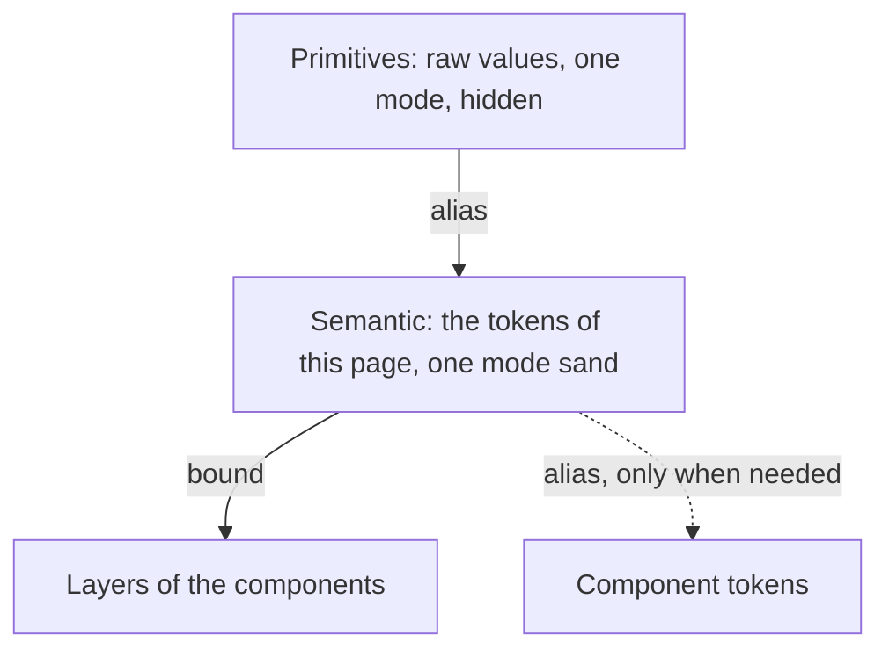

# Foundations

> [Home](../README.md) › [Design system](README.md) › Foundations

Status: first draft, written by the assistant on 2026-11-22, drawn on the page Foundations of the Figma file the same day; written as W3C Design Tokens (DTCG 2025.10) on 2026-11-23. The families are chosen; every other value here is **proposed**, to review on screen. The colours come from the Warm Sand theme of the old design system ([Principles](01-principles.md)).

Each block below is the source of its tokens: the same names and values in Figma (collection `semantic`) and in code (`text-primary` is `--ss-text-primary` in CSS).

## How the tokens are layered

Two layers to start with; a third only when a component must differ from the shared roles.



| Collection | Holds | Modes |
| --- | --- | --- |
| `primitives` | The raw colours (`sand/05` to `sand/90`, `white`, `black` and its veils, the accents) and one number scale (`scale/1` to `scale/999`). Never bound to a layer. | One: `value` |
| `semantic` | The tokens of this page, each an alias of a primitive. | One: `sand` |

## Colours

Every pair of text and background passes 4.5:1, every border and icon of a control 3:1 against its neighbour (WCAG 2.2 AA); disabled text is exempt.

### Surfaces

The veils `layer-transparent`, `layer-hover`, `layer-pressed` and `layer-active` are black and transparent, so that they darken whatever is under them: `background`, `layer-01`, or a selected line.

```tokens
{
  "color": {
    "$type": "color",
    "background": {
      "$value": { "colorSpace": "srgb", "components": [0.875, 0.851, 0.788], "hex": "#dfd9c9" },
      "$description": "The window behind everything."
    },
    "layer-01": {
      "$value": { "colorSpace": "srgb", "components": [0.914, 0.886, 0.827], "hex": "#e9e2d3" },
      "$description": "Panels, columns, the top bar, the rail."
    },
    "layer-02": {
      "$value": { "colorSpace": "srgb", "components": [0.953, 0.925, 0.867], "hex": "#f3ecdd" },
      "$description": "A surface on a panel: a field, a table header."
    },
    "layer-transparent": {
      "$value": { "colorSpace": "srgb", "components": [0, 0, 0], "alpha": 0, "hex": "#000000" },
      "$description": "The rest state of a component that has a hover veil, so that the hover fades in."
    },
    "layer-hover": {
      "$value": { "colorSpace": "srgb", "components": [0, 0, 0], "alpha": 0.07, "hex": "#000000" },
      "$description": "A line, a button or an item under the mouse."
    },
    "layer-pressed": {
      "$value": { "colorSpace": "srgb", "components": [0, 0, 0], "alpha": 0.13, "hex": "#000000" },
      "$description": "A button or an item while the mouse button is down."
    },
    "layer-active": {
      "$value": { "colorSpace": "srgb", "components": [0, 0, 0], "alpha": 0.17, "hex": "#000000" },
      "$description": "A press over a pressed surface. No component uses it since 2026-11-22."
    },
    "layer-selected": {
      "$value": { "colorSpace": "srgb", "components": [0.839, 0.804, 0.929], "hex": "#d6cded" },
      "$description": "The selected line, item or part."
    },
    "layer-inverse": {
      "$value": { "colorSpace": "srgb", "components": [0.094, 0.086, 0.071], "hex": "#181612" },
      "$description": "A tooltip."
    },
    "overlay": {
      "$value": { "colorSpace": "srgb", "components": [0, 0, 0], "alpha": 0.6, "hex": "#000000" },
      "$description": "The veil behind a dialog."
    }
  }
}
```

### Borders

```tokens
{
  "color": {
    "$type": "color",
    "border-subtle": {
      "$value": { "colorSpace": "srgb", "components": [0.831, 0.804, 0.745], "hex": "#d4cdbe" },
      "$description": "Separators, table lines."
    },
    "border-strong": {
      "$value": { "colorSpace": "srgb", "components": [0.475, 0.467, 0.451], "hex": "#797773" },
      "$description": "The border of a field, a checkbox, a radio."
    }
  }
}
```

### Text and icons

```tokens
{
  "color": {
    "$type": "color",
    "text-primary": {
      "$value": { "colorSpace": "srgb", "components": [0.094, 0.086, 0.071], "hex": "#181612" },
      "$description": "Text, values."
    },
    "text-secondary": {
      "$value": { "colorSpace": "srgb", "components": [0.29, 0.278, 0.263], "hex": "#4a4743" },
      "$description": "Labels, headers, inherited lines."
    },
    "text-placeholder": {
      "$value": { "colorSpace": "srgb", "components": [0.388, 0.376, 0.357], "hex": "#63605b" },
      "$description": "The hint in an empty field."
    },
    "text-disabled": {
      "$value": { "colorSpace": "srgb", "components": [0.545, 0.537, 0.522], "hex": "#8b8985" },
      "$description": "Text of a disabled control."
    },
    "text-on-accent": {
      "$value": { "colorSpace": "srgb", "components": [1, 1, 1], "hex": "#ffffff" },
      "$description": "Text on an accent or a danger button."
    },
    "text-inverse": {
      "$value": { "colorSpace": "srgb", "components": [1, 1, 1], "hex": "#ffffff" },
      "$description": "Text of a tooltip."
    },
    "icon-primary": {
      "$value": { "colorSpace": "srgb", "components": [0.094, 0.086, 0.071], "hex": "#181612" },
      "$description": "Icons of the controls."
    },
    "icon-secondary": {
      "$value": { "colorSpace": "srgb", "components": [0.29, 0.278, 0.263], "hex": "#4a4743" },
      "$description": "Quiet icons: the + on hover, a handle."
    }
  }
}
```

### Accent and focus

The focus is two lines: `focus-inset` against the control, then `focus` around it ([Skill rules R7](skill-rules.md#r7--focus-as-a-double-line)).

```tokens
{
  "color": {
    "$type": "color",
    "accent": {
      "$value": { "colorSpace": "srgb", "components": [0.424, 0.325, 0.612], "hex": "#6c539c" },
      "$description": "The main action, the checked state, the selected part."
    },
    "accent-hover": {
      "$value": { "colorSpace": "srgb", "components": [0.357, 0.275, 0.545], "hex": "#5b468b" },
      "$description": "The accent under the mouse."
    },
    "accent-pressed": {
      "$value": { "colorSpace": "srgb", "components": [0.298, 0.235, 0.447], "hex": "#4c3c72" },
      "$description": "The accent while the mouse button is down."
    },
    "focus": {
      "$value": { "colorSpace": "srgb", "components": [0.298, 0.235, 0.447], "hex": "#4c3c72" },
      "$description": "The outer, dark line of the focus."
    },
    "focus-inset": {
      "$value": { "colorSpace": "srgb", "components": [1, 1, 1], "hex": "#ffffff" },
      "$description": "The inner, light line of the focus."
    }
  }
}
```

### Status

```tokens
{
  "color": {
    "$type": "color",
    "danger": {
      "$value": { "colorSpace": "srgb", "components": [0.549, 0.29, 0.275], "hex": "#8c4a46" },
      "$description": "A delete in a warning, an error."
    },
    "danger-hover": {
      "$value": { "colorSpace": "srgb", "components": [0.42, 0.212, 0.2], "hex": "#6b3633" },
      "$description": "A danger button under the mouse or pressed."
    },
    "warning": {
      "$value": { "colorSpace": "srgb", "components": [0.486, 0.337, 0.098], "hex": "#7c5619" },
      "$description": "A warning that does not block, such as a required designation left empty."
    },
    "success": {
      "$value": { "colorSpace": "srgb", "components": [0.188, 0.412, 0.247], "hex": "#30693f" },
      "$description": "A check that passed."
    }
  }
}
```

## Typography

One family for the whole interface, **IBM Plex Sans**, one for code (the Markdown mode, formulas), **IBM Plex Mono**: both free (SIL Open Font License).

```tokens
{
  "font": {
    "$type": "fontFamily",
    "sans": { "$value": "IBM Plex Sans", "$description": "The whole interface." },
    "mono": { "$value": "IBM Plex Mono", "$description": "Code: the Markdown mode, formulas." }
  }
}
```

### Styles of the interface

The line height is given as a ratio of the size, as DTCG asks; the description gives it in pixels.

```tokens
{
  "typography": {
    "$type": "typography",
    "caption": {
      "$value": { "fontFamily": "IBM Plex Sans", "fontSize": { "value": 12, "unit": "px" }, "fontWeight": 400, "lineHeight": 1.333, "letterSpacing": { "value": 0, "unit": "px" } },
      "$description": "12 / 16. Help under a field, a table header."
    },
    "body": {
      "$value": { "fontFamily": "IBM Plex Sans", "fontSize": { "value": 14, "unit": "px" }, "fontWeight": 400, "lineHeight": 1.429, "letterSpacing": { "value": 0, "unit": "px" } },
      "$description": "14 / 20. Every control, every value, every line."
    },
    "body-strong": {
      "$value": { "fontFamily": "IBM Plex Sans", "fontSize": { "value": 14, "unit": "px" }, "fontWeight": 600, "lineHeight": 1.429, "letterSpacing": { "value": 0, "unit": "px" } },
      "$description": "14 / 20. The title of a list, a selected part."
    },
    "heading": {
      "$value": { "fontFamily": "IBM Plex Sans", "fontSize": { "value": 16, "unit": "px" }, "fontWeight": 600, "lineHeight": 1.5, "letterSpacing": { "value": 0, "unit": "px" } },
      "$description": "16 / 24. The title of a column or a dialog."
    },
    "title": {
      "$value": { "fontFamily": "IBM Plex Sans", "fontSize": { "value": 20, "unit": "px" }, "fontWeight": 600, "lineHeight": 1.4, "letterSpacing": { "value": 0, "unit": "px" } },
      "$description": "20 / 28. Rare: the name of an empty screen."
    },
    "code": {
      "$value": { "fontFamily": "IBM Plex Mono", "fontSize": { "value": 13, "unit": "px" }, "fontWeight": 400, "lineHeight": 1.538, "letterSpacing": { "value": 0, "unit": "px" } },
      "$description": "13 / 20. Markdown, formulas."
    }
  }
}
```

### Styles of a description

The text a user writes in the visual editor of a description ([markdown-editor](08-organisms/markdown-editor.md)). Its paragraph is `body`, its bold `body-strong`, its code `code`. Every heading is larger than the paragraph, down to Heading 6, so that a bold line never reads as a heading. Sizes proposed.

```tokens
{
  "typography": {
    "$type": "typography",
    "content-h1": {
      "$value": { "fontFamily": "IBM Plex Sans", "fontSize": { "value": 28, "unit": "px" }, "fontWeight": 600, "lineHeight": 1.286, "letterSpacing": { "value": 0, "unit": "px" } },
      "$description": "28 / 36. Heading 1."
    },
    "content-h2": {
      "$value": { "fontFamily": "IBM Plex Sans", "fontSize": { "value": 24, "unit": "px" }, "fontWeight": 600, "lineHeight": 1.333, "letterSpacing": { "value": 0, "unit": "px" } },
      "$description": "24 / 32. Heading 2."
    },
    "content-h3": {
      "$value": { "fontFamily": "IBM Plex Sans", "fontSize": { "value": 20, "unit": "px" }, "fontWeight": 600, "lineHeight": 1.4, "letterSpacing": { "value": 0, "unit": "px" } },
      "$description": "20 / 28. Heading 3."
    },
    "content-h4": {
      "$value": { "fontFamily": "IBM Plex Sans", "fontSize": { "value": 18, "unit": "px" }, "fontWeight": 600, "lineHeight": 1.444, "letterSpacing": { "value": 0, "unit": "px" } },
      "$description": "18 / 26. Heading 4."
    },
    "content-h5": {
      "$value": { "fontFamily": "IBM Plex Sans", "fontSize": { "value": 17, "unit": "px" }, "fontWeight": 600, "lineHeight": 1.412, "letterSpacing": { "value": 0, "unit": "px" } },
      "$description": "17 / 24. Heading 5."
    },
    "content-h6": {
      "$value": { "fontFamily": "IBM Plex Sans", "fontSize": { "value": 16, "unit": "px" }, "fontWeight": 600, "lineHeight": 1.5, "letterSpacing": { "value": 0, "unit": "px" } },
      "$description": "16 / 24. Heading 6: still larger than a bold paragraph (14)."
    }
  }
}
```

For comparison, Figma's interface puts its controls in 24 px high lines, with a much smaller text (see [Principles](01-principles.md#dense-but-larger-than-figma)).

## Spacing

A scale on a 4 px base. Usual gaps: 8 between two controls, 12 between a label and its control, 16 from the edge of a panel.

```tokens
{
  "spacing": {
    "$type": "dimension",
    "spacing-01": { "$value": { "value": 2, "unit": "px" } },
    "spacing-02": { "$value": { "value": 4, "unit": "px" } },
    "spacing-03": { "$value": { "value": 8, "unit": "px" }, "$description": "Between two controls; between a title and its first line." },
    "spacing-04": { "$value": { "value": 12, "unit": "px" }, "$description": "Between a label and its control." },
    "spacing-05": { "$value": { "value": 16, "unit": "px" }, "$description": "From the edge of a panel." },
    "spacing-06": { "$value": { "value": 24, "unit": "px" } },
    "spacing-07": { "$value": { "value": 32, "unit": "px" } },
    "spacing-08": { "$value": { "value": 48, "unit": "px" } }
  }
}
```

## Sizes

```tokens
{
  "size": {
    "$type": "dimension",
    "size-control-sm": { "$value": { "value": 28, "unit": "px" }, "$description": "A control inside a table cell." },
    "size-control-md": { "$value": { "value": 32, "unit": "px" }, "$description": "Every control by default: button, field, select, menu item." },
    "size-control-lg": { "$value": { "value": 40, "unit": "px" }, "$description": "A main action in a dialog." },
    "size-row": { "$value": { "value": 36, "unit": "px" }, "$description": "A line of a table, a list, the tree." },
    "size-icon-sm": { "$value": { "value": 16, "unit": "px" }, "$description": "An icon in a control of 28 or 32." },
    "size-icon-md": { "$value": { "value": 20, "unit": "px" }, "$description": "An icon of the rail, of the top bar, of a 40 control." },
    "size-top-bar": { "$value": { "value": 40, "unit": "px" }, "$description": "Height of the top bar." },
    "size-rail": { "$value": { "value": 48, "unit": "px" }, "$description": "Width of the navigation rail." },
    "size-left-column": { "$value": { "value": 320, "unit": "px" }, "$description": "Width of the left column (tree, lists) at 1600 × 900." }
  }
}
```

## Radii

```tokens
{
  "radius": {
    "$type": "dimension",
    "radius-sm": { "$value": { "value": 4, "unit": "px" }, "$description": "Controls: button, field, checkbox, menu item; every line of a list, a tree or a table." },
    "radius-md": { "$value": { "value": 8, "unit": "px" }, "$description": "Panels, menus, dialogs." },
    "radius-full": { "$value": { "value": 999, "unit": "px" }, "$description": "Toggle, radio, round badges, and their focus." }
  }
}
```

## Borders

```tokens
{
  "border": {
    "$type": "dimension",
    "border-width": { "$value": { "value": 1, "unit": "px" }, "$description": "Every border." },
    "focus-width": { "$value": { "value": 2, "unit": "px" }, "$description": "A selected swatch, a checked radio, an open select." }
  }
}
```

## Shadows

`focus-ring` and `focus-ring-inset` are each two spreads with no blur: 2 px of `focus-inset`, then 2 px of `focus`. The focus follows the shape of its control: round on a radio, rounded on a button. In Figma every control draws them as two lines, since the SVG export of a spread is wrong ([Figma file](04-figma-file.md#ways-of-figma-to-keep-in-mind)).

```tokens
{
  "shadow": {
    "$type": "shadow",
    "shadow-raised": {
      "$value": { "color": { "colorSpace": "srgb", "components": [0, 0, 0], "alpha": 0.16, "hex": "#000000" }, "offsetX": { "value": 0, "unit": "px" }, "offsetY": { "value": 2, "unit": "px" }, "blur": { "value": 8, "unit": "px" }, "spread": { "value": 0, "unit": "px" } },
      "$description": "Menus, tooltips, the floating bars of the symbol editor."
    },
    "shadow-overlay": {
      "$value": { "color": { "colorSpace": "srgb", "components": [0, 0, 0], "alpha": 0.24, "hex": "#000000" }, "offsetX": { "value": 0, "unit": "px" }, "offsetY": { "value": 8, "unit": "px" }, "blur": { "value": 24, "unit": "px" }, "spread": { "value": 0, "unit": "px" } },
      "$description": "Dialogs."
    },
    "focus-ring": {
      "$value": [
        { "color": { "colorSpace": "srgb", "components": [1, 1, 1], "hex": "#ffffff" }, "offsetX": { "value": 0, "unit": "px" }, "offsetY": { "value": 0, "unit": "px" }, "blur": { "value": 0, "unit": "px" }, "spread": { "value": 2, "unit": "px" } },
        { "color": { "colorSpace": "srgb", "components": [0.298, 0.235, 0.447], "hex": "#4c3c72" }, "offsetX": { "value": 0, "unit": "px" }, "offsetY": { "value": 0, "unit": "px" }, "blur": { "value": 0, "unit": "px" }, "spread": { "value": 4, "unit": "px" } }
      ],
      "$description": "The keyboard focus of a control, outside it."
    },
    "focus-ring-inset": {
      "$value": [
        { "color": { "colorSpace": "srgb", "components": [1, 1, 1], "hex": "#ffffff" }, "offsetX": { "value": 0, "unit": "px" }, "offsetY": { "value": 0, "unit": "px" }, "blur": { "value": 0, "unit": "px" }, "spread": { "value": 2, "unit": "px" }, "inset": true },
        { "color": { "colorSpace": "srgb", "components": [0.298, 0.235, 0.447], "hex": "#4c3c72" }, "offsetX": { "value": 0, "unit": "px" }, "offsetY": { "value": 0, "unit": "px" }, "blur": { "value": 0, "unit": "px" }, "spread": { "value": 4, "unit": "px" }, "inset": true }
      ],
      "$description": "The keyboard focus of a line of a list, a tree or a table, inside it."
    }
  }
}
```

## Where it is used

| Where | What it uses |
| --- | --- |
| [Components](03-components.md) | Every value of every component is one of these tokens. |
| [Figma file](04-figma-file.md) | The collection `semantic` and the text and effect styles, with the same names. |
| Repository `synoptic-studio-design-system` | The same tokens, exported as W3C Design Tokens (DTCG) JSON. |
