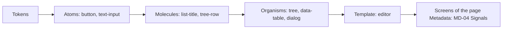

# Components

> [Home](../README.md) › [Design system](README.md) › Components

Status: first draft, written by the assistant on 2026-11-22 from the [kinds of control](../screens/README.md#kinds-of-control), the [layout rules](../screens/README.md#layout-rules) and the [screens of Metadata](../screens/metadata.md). Not validated.

The rules every component follows. Each component has its own sheet, in the folder of its level. A component is named after its structure, never after a screen, with the same name in Figma and in code (`text-input` is `atoms/text-input/` in `synoptic-studio-design-system`); variants are written `property=value`.

## The levels

How the levels build on each other, with an example per level.

| Level | Folder | Sheets |
| --- | --- | --- |
| Icons | [icons](icons/README.md) | 50 icons, exported as SVG |
| Atoms | [atoms](atoms/README.md) | 16 |
| Molecules | [molecules](molecules/README.md) | 16 |
| Organisms | [organisms](organisms/README.md) | 14 |
| Templates | [templates](templates/README.md) | 1 |
| Screens | [metadata](metadata/README.md) | the 42 frames of the page Metadata |

Only the components the screens of Metadata use have a sheet; each level's README lists the ones left out.

## What a sheet holds

| Section | What it says |
| --- | --- |
| Title and first line | Its name, what it is, and when another component fits better. |
| Figma | A table of its nodes, each id linked to it. |
| Variants and states | The table of the Figma file, exported as SVG. |
| Inputs | What the code gives it: name, type, default, and the Figma property it matches. |
| Outputs | What it tells the code: the event, when, and its value. |
| Behaviour | What the table cannot show: mouse, keyboard, overflow. |
| Made of | The components it holds and their role; none for an atom. |

A state that comes from the mouse or the keyboard is never an input. A sheet says what a component is made of, never where it is used.

## States every interactive component has

| State | When |
| --- | --- |
| `default` | At rest. |
| `hover` | The mouse is over it. |
| `pressed` | The mouse button is down on it; a field has none, a click puts it in `focus`. |
| `focus` | Reached with the keyboard: the double focus line (`focus-ring`, or `focus-ring-inset` on a line), following the shape of the control, on the hover background when the component has none. |
| `disabled` | Cannot be used. |

## Rules for every component

- **Lines of a list**: rounded (`radius-sm`), `spacing-03` from the sides of their list and `spacing-01` apart, with no line under them except the header of a table.
- **Selected**: what is selected and cannot be clicked again does not react to the mouse, except a `toggle-button` on and the + of a selected `tree-row`.
- **Dragging**: a line turns `dragging` only while its handle is held.
- **Veils**: hover, press and drag are a dark veil over the component's background, transparent at rest (`layer-transparent`, `layer-hover`, `layer-pressed`, `layer-active`).
- **Lists that open**: 280 high at most, then they scroll inside, `spacing-04` from the window's edge, the last item with the same margin as the first.
- **Focus outside**: the focus line is drawn outside the control and never cut, except by a surface with a background, which leaves room for it.
- **Strokes**: a line that thickens in a state never moves the content.
- **One line of text**: it never wraps; what does not fit ends with "…".
- **Slots**: a part whose content changes from one screen to the next is a slot, filled with instances.
- **Open with the keyboard**: a control that opens a list keeps the focus line while open only when the keyboard opened it (`open-focus`).
- **Leaving focus**: leaving `focus` or `open` always goes back to `default`.
- **Shown as tables**: every component is shown in Figma as a table of its variants and states ([Figma file](04-figma-file.md#how-a-page-shows-its-components)).
- **Prototyped**: every interactive component is prototyped in its component set: hover, press, and a click to the next state ([Skill rules R8](skill-rules.md#r8--components-prototyped-on-their-own)).

## Content states drawn on the page Metadata

Each screen of Metadata is drawn with real content, then once for each state it can show.

| State | Example |
| --- | --- |
| Empty | A type with no signal; no enum yet. |
| One item | One signal. |
| Many items | A deep tree, 40 signals, a table that scrolls. |
| Long text | A long ID, a long description. |
| Error | A line in error (decision 0082); an ID already taken refused when typed (decision 0083). |
| Inherited | A sub-type with inherited signals and commands. |

## Where it is used

| Where | What it uses |
| --- | --- |
| [Screens](../screens/README.md) | Every control of every screen is one of these components. |
| [Number and text fields](../controls/number-and-text-fields.md) | `number-input`, `text-input`. |
| Repository `synoptic-studio-design-system` | The same components, presentational, with the same names, inputs and outputs. |
