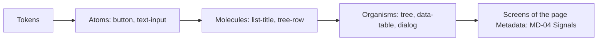

# Components

> [Home](../README.md) › [Design system](README.md) › Components

Status: first draft, written by the assistant on 2026-11-22 from the [kinds of control](../screens/README.md#kinds-of-control), the [layout rules](../screens/README.md#layout-rules) and the [screens of Metadata](../screens/metadata.md). Not validated.

Every component is named after its structure, never after a screen; the same name in Figma and in code (`text-input` is `atoms/text-input/` in `synoptic-studio-design-system`). Variants are written `property=value`.

## The levels

How the levels build on each other, with an example per level.

## States every interactive component has

| State | When |
| --- | --- |
| `default` | At rest. |
| `hover` | The mouse is over it. |
| `pressed` | The mouse button is down on it. |
| `focus` | Reached with the keyboard: the double focus line (`focus-ring`, or `focus-ring-inset` on a line), on the hover background when the component has none. |
| `disabled` | Cannot be used. |

A line of a list, a tree or a table (`tree-row`, `list-row`, `part-item`, `menu-item`, `data-table-row`) has rounded corners, `radius-sm`, like every control (Product Owner, 2026-11-22: "si on met un border radius, j'aimerais bien qu'il soit partout"). Its list (`tree`, `part-list`, `list-panel`, `data-table`) leaves `spacing-03` on each side and `spacing-01` between lines, so a line in `hover` or `selected` never touches the edges. A line has no line under it: a stroke on a rounded shape thins at its corners; lines are told apart by the `spacing-01` between them, and only the header of a table keeps a straight line under it.

The tables below add the states each component needs on top of these. A field (`text-input`, `number-input`, `text-area`) has no `pressed`: a click puts it in `focus`.

A text on one line (a field, a select, a line of a list, a tree or a table) never wraps: what does not fit ends with "…".

A part whose content changes from one screen to the next is a slot, filled on the screen with instances: the lines of `tree`, `list-panel` and `data-table` (`rows`), the column headers of `data-table-header` (`columns`), the cells of `data-table-row` (`cells`), the add buttons of `list-title` with several kinds (`actions`), the fields of `faceplate-element` (`fields`), and the add buttons and the elements of a group (`actions`, `elements`). So a table has the columns of its screen, and a list as many lines as its content.

Every component is shown in the Figma file as a table of its variants and its states, grouped by family: see [Figma file](05-figma-file.md#how-a-page-shows-its-components) and [Skill rules R9](skill-rules.md#r9--components-shown-as-tables-of-variants-and-states).

Every interactive component is prototyped in its component set: `hover` while the mouse is over it, `pressed` while its button is down, and a click to the next state (checked, on, open, selected, expanded). See [Skill rules R8](skill-rules.md#r8--components-prototyped-on-their-own).

## Atoms

| Component | Variants | States added | Screens |
| --- | --- | --- | --- |
| `icon` | One component per icon of [Icons](03-icons.md), `icon/<name>`; the size is set on the instance, `size-icon-sm` (16) or `size-icon-md` (20), never a variant | — | Everywhere |
| `button` | `kind=primary, secondary, ghost, danger`; `size=md, lg`; leading icon on or off | — | Dialogs: Cancel, Delete |
| `icon-button` | `kind=ghost, quiet` (quiet: `icon-secondary`, the + on hover); `size=sm, md` | `selected` | Every + of a title, delete, reset, search, full page |
| `text-input` | `size=sm, md` (sm in a table cell); with or without a trailing icon | `filled`, `read-only`, `error` | MD-02.1, MD-03.8, every ID |
| `number-input` | `size=sm, md`; with or without a unit; with or without the `variable` icon | `filled`, `read-only`, `error`, `variable` (the value comes from a signal) | MD-07.13, MD-07.22, MD-08.13, MD-09.6 |
| `text-area` | — | `filled`, `read-only`, `error` | MD-09.11, the description element |
| `select-trigger` | `size=sm, md`; with or without a leading icon | `open`, `filled`, `read-only`, `error` | MD-04.7 to MD-04.12, MD-05.4, MD-07.12; with the icon `signal-input` or `signal-output` for a direction (MD-04.12, MD-07.9), `quantity` or `difference` for a quantity (MD-04.9) |
| `checkbox` | `checked=false, true, mixed` | — | MD-13.8 |
| `radio` | `checked=false, true` | — | MD-07.11 |
| `toggle` | `on=false, true` | — | Boolean input of a faceplate (MD-07.10) |
| `drag-handle` | — | `dragging` | Every ordered table |
| `label` | `required=false, true` | — | Every field outside a table |
| `tooltip` | `placement=top, right, bottom, left` | — | Every icon alone |
| `colour-swatch` | `size=sm, md` | `selected` | MD-02.6 |
| `divider` | `direction=horizontal, vertical` | — | Rail, panels |
| `column-header` | — (text `label`; its width is the width of its column) | — | The head of every column of a `data-table-header` |

## Molecules

| Component | Made of | Variants | States added | Screens |
| --- | --- | --- | --- | --- |
| `field` | `label` + one input atom + help text | `layout=stacked, inline` | `error` (help in `danger`) | General, Units |
| `menu-item` | `icon` + text + check | with or without icon | `selected` | Every select |
| `menu` | `menu-item` × n | — | — | Every select |
| `select` | `select-trigger` + `menu` | — | `open` | Every select |
| `segmented-control` | two or three `button` side by side | `items=2, 3`; `selected=1, 2, 3` (the item selected) | — | MD-07.2b Values / Faceplate, MD-03.4b Read only / Visual / Markdown |
| `radio-group` | `radio` × n + labels | `orientation=horizontal, vertical` | — | MD-07.11, enum input of a faceplate |
| `list-title` | text `body-strong` + `icon-button` × n (one + per kind, search) | `actions=add, search-add, several-add`; `several-add` holds its buttons in the slot `actions`, empty for a title with no button (Quantities, Unit systems) | `searching` (the title becomes a `text-input`, the + a `dismiss`) | Every list and table: Type tree, Signals, Links, Elements |
| `nav-rail-item` | `icon-button` + `tooltip`; a square of `size-control-lg` in the rail, a square of `size-top-bar` with a `size-control-md` button and the same margin on every side in the top bar | `placement=rail, top-bar` | `selected`: the `layer-selected` background; in the top bar, a bar of `accent` under it too, no bar in the rail (Product Owner, 2026-11-22: "la barre [...] devrait être en bas"; in the rail, "à toi de choisir") | MD-00, top bar |
| `tree-row` | `icon` chevron + type `icon` in its colour + name + quiet `add` | `depth=0…n`; `has-children=false, true` | `selected`, `expanded` | MD-01.1, MD-01.3 |
| `list-row` | name + `icon-button` delete | with or without delete | `selected` | Presets (without delete since 2026-11-22: a preset is deleted by its red button), Enums, Unit systems |
| `part-item` | text of a part | — | `selected` | MD-01.5 |
| `link-cell` | `folder` or `link` icon + path or URL | `kind=path, url` | — | MD-03.9 |
| `quantity-cell` | `quantity` or `difference` icon + name | `kind=quantity, difference` | — | Deprecated (2026-11-22): the quantity is chosen in the table, so its cell is a `select-trigger` with the icon (Product Owner: "ça doit pouvoir être sélectionné autant que les autres") |
| `direction-cell` | `signal-input` or `signal-output` icon + text; the icon in `icon-primary`, the same colour for both directions | `direction=input, output` | — | Deprecated (2026-11-22): the direction is a select too (MD-04.12), a `select-trigger` with the icon |
| `toolbar-group` | `icon-button` × n | — | — | MD-03.4d |
| `window-controls` | minimise, maximise or restore, close | `platform=windows, macos` | — | Top bar |

## Organisms

| Component | Made of | Variants | States added | Screens |
| --- | --- | --- | --- | --- |
| `top-bar` | `app-mark` + `nav-rail-item` × 3 (`placement=top-bar`, the parts) + `window-controls` | `platform=windows, macos, browser` | one part `selected` | Every screen |
| `nav-rail` | `nav-rail-item` × n + `divider` | — | one item `selected` | MD-00, SY-00 |
| `tree` | `list-title` + `tree-row` × n | — | `searching`, `empty` | MD-01 |
| `part-list` | `part-item` × n | — | one part `selected` | MD-01.5 |
| `data-table` | `list-title` + `data-table-header` + `data-table-row` × n (`drag-handle`, inputs, cell molecules, delete), on `layer-01` with `radius-md`; padding `spacing-04` top and bottom, `spacing-03` left and right, so the buttons of its corners sit 16 from each edge (Product Owner, 2026-11-22: the same margin at the top, the bottom and the sides) | — | table `empty` | MD-03.5, MD-04, MD-05, MD-07.7, MD-08.7, MD-09.5, MD-12, MD-13 |
| `data-table-header` | the room of the handle, the slot `columns` of `column-header`, the room of the delete button | — | — | Every data-table |
| `data-table-row` | `drag-handle`, the slot `cells`, the delete `icon-button`; its default cells are the columns of Signals | `kind=default, inherited, error`; no background per direction (Product Owner, 2026-11-22: the direction is told by its icon only) | `hover`; `dragging` (held by its handle: `layer-selected` and `shadow-raised`), own lines only; no `selected`, a line of a table is never selected; `inherited`: read only, no handle nor delete, nothing that tells its parent (Product Owner, 2026-11-22: the tree already shows it) | Every data-table |
| `list-panel` | `list-title` + `list-row` × n | — | `empty` | MD-07.1, MD-08.1, MD-09.1 |
| `dialog` | `heading` + text + `button` × 2; `kind=form`: `heading` + `field` × n + Cancel and a primary button | `kind=warning, danger, form` | — | Every delete; `form`: Add a URL (MD-03.7) |
| `formatting-toolbar` | `toolbar-group` × n + `segmented-control` (two items: Visual, Markdown) + full-page `icon-button`; the same groups in both modes | `mode=visual, markdown` | — | MD-03.4d |
| `markdown-editor` | `list-title` "Description" (no action) + `formatting-toolbar` + editing area | `mode=visual, markdown` (no read-only, Product Owner, 2026-11-22) | `full-page`: the editing area fills down to the bottom | MD-03.1b to MD-03.4c |
| `faceplate-element` | `drag-handle` + kind `icon` + the slot `fields` + delete; a signal in write or override puts its input on a second line, under its fields: the kind of input, then the minimum and the maximum, of the same width (Product Owner, 2026-11-22); a group adds the slot `actions` (its five add buttons) and, under it, the slot `elements` (its own elements, indented by `spacing-07`) | `kind=signal, command, title, paragraph, group` | `selected` | MD-07.18 to MD-07.20; read or write is a horizontal `radio-group` (MD-07.11) |
| `palette-picker` | `colour-swatch` × n + `reset`; the swatches show sample colours until the palette of the project is known | — | — | MD-02.6, MD-02.7 |
| `icon-picker` | `icon-button` × n + `reset` | — | — | MD-02.5, MD-02.7 |

## Content states drawn on the page Metadata

Each screen of Metadata is drawn with real content, then once for each state it can show.

| State | Example |
| --- | --- |
| Empty | A type with no signal; no enum yet. |
| One item | One signal. |
| Many items | A deep tree, 40 signals, a table that scrolls. |
| Long text | A long ID, a long description. |
| Error | A line in error (decision 0082); an ID already taken refused when typed (decision 0083). |
| Inherited | A sub-type with inherited signals and commands. |

## Where it is used

| Where | What it uses |
| --- | --- |
| [Screens](../screens/README.md) | Every control of every screen is one of these components. |
| [Number and text fields](../controls/number-and-text-fields.md) | `number-input`, `text-input`. |
| Repository `synoptic-studio-design-system` | The same components, presentational, with the same names. |
