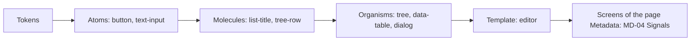

# Components

> [Home](../README.md) › [Design system](README.md) › Components

Status: first draft, written by the assistant on 2026-11-22 from the [kinds of control](../screens/README.md#kinds-of-control), the [layout rules](../screens/README.md#layout-rules) and the [screens of Metadata](../screens/metadata.md). Not validated.

The rules every component follows. Each component has its own sheet, in the folder of its level: what it is, its link in Figma, the table of its variants and states exported from Figma, its inputs and outputs, its behaviour, and the components it is made of.

Every component is named after its structure, never after a screen; the same name in Figma and in code (`text-input` is `atoms/text-input/` in `synoptic-studio-design-system`). Variants are written `property=value`.

## The levels

How the levels build on each other, with an example per level.

| Level | Folder | Sheets |
| --- | --- | --- |
| Icons | [icons](icons/README.md) | 50 icons, exported as SVG |
| Atoms | [atoms](atoms/README.md) | 16 |
| Molecules | [molecules](molecules/README.md) | 16 |
| Organisms | [organisms](organisms/README.md) | 14 |
| Templates | [templates](templates/README.md) | 1 |
| Screens | [metadata](metadata/README.md) | the 42 frames of the page Metadata |

Only the components the screens of Metadata use have a sheet (Product Owner, 2026-11-22: "que les composants qui sont vraiment dans les métadatas, et rien d'autre pour l'instant"). Each level's README lists the components left out.

## What a sheet holds

| Section | What it says |
| --- | --- |
| Title and first line | Its name, what it is, and when another component fits better. |
| Figma | A table of its nodes: its component or component set, and the variants worth reaching, each id linked to it. |
| Variants and states | The table of the Figma file, exported as SVG. |
| Inputs | What the code gives it: name, type, default, and the Figma property it matches. |
| Outputs | What it tells the code: the event, when, and its value. |
| Behaviour | What the table cannot show: mouse, keyboard, overflow, the decisions of the Product Owner. |
| Made of | The components it holds and their role; none for an atom. |

A state that comes from the mouse or the keyboard (`hover`, `pressed`, `focus`) is never an input. A sheet says what a component is made of, never where it is used (Product Owner, 2026-11-22: "j'ai pas besoin de savoir où il est utilisé en amont").

## States every interactive component has

| State | When |
| --- | --- |
| `default` | At rest. |
| `hover` | The mouse is over it. |
| `pressed` | The mouse button is down on it. |
| `focus` | Reached with the keyboard: the double focus line (`focus-ring`, or `focus-ring-inset` on a line), on the hover background when the component has none. |
| `disabled` | Cannot be used. |

A field (`text-input`, `number-input`, `text-area`) has no `pressed`: a click puts it in `focus`.

## Rules for every component

- **Lines of a list.** A line of a list, a tree or a table has rounded corners, `radius-sm`, like every control (Product Owner, 2026-11-22: "si on met un border radius, j'aimerais bien qu'il soit partout"). Its list leaves `spacing-03` on each side and `spacing-01` between lines, so a line in `hover` or `selected` never touches the edges. A line has no line under it: only the header of a table keeps a straight line under it.
- **What is selected does not react.** What is selected and cannot be clicked again (the item of a `segmented-control`, a line of a list, a part, an item of the rail or of the top bar, a swatch, the chosen item of a menu) does not react to the mouse: no hover, no press, no click (Product Owner, 2026-11-22). Two exceptions: a `toggle-button` turned on still reacts, since a click turns it off; a selected `tree-row` still shows its + on hover, since a sub-type can be added to it (Product Owner, 2026-11-22).
- **Dragging.** A line turns violet (`dragging`) only while its handle is held, never on a click of the line (Product Owner, 2026-11-22): tables and faceplate elements alike.
- **Veils.** The hover, the press and the drag are a dark veil laid over the component's own background (`layer-hover`, `layer-pressed`, `layer-active`). At rest the component holds the same veil, transparent (`layer-transparent`), so that the change only fades the veil in.
- **Lists that open.** A list that opens over the page (a menu, a select, a picker) is 280 high at most: beyond, it scrolls inside, with a `scrollbar`, and it always stays `spacing-04` from the edge of the window. The height of 280 is the assistant's choice. Once scrolled to the end, its last item keeps the same margin as the first (Product Owner, 2026-11-22).
- **Focus outside.** The double focus line is drawn outside the control: no frame without a background cuts what overflows it, so the line shows whole even when a field touches the edge of its column, its cell or its slot. Only a surface with a background and rounded corners cuts, and it leaves room for the line with its padding.
- **Strokes do not move the content.** A line that gets thicker in a state (`open`, `error`, `selected`) is drawn over the padding: the text and the icons stay in place (Product Owner, 2026-11-22: "le texte se déplace alors qu'il ne devrait pas").
- **One line of text.** A text on one line (a field, a select, a line of a list, a tree or a table) never wraps: what does not fit ends with "…".
- **Slots.** A part whose content changes from one screen to the next is a slot, filled on the screen with instances: the lines of `tree`, `list-panel` and `data-table`, the column headers, the cells of a line, the add buttons of `list-title`, the fields and elements of `faceplate-element`.
- **Open with the keyboard.** A control that opens a list keeps the double focus line while open only when the keyboard opened it (`open-focus`); opened with the mouse, it shows the line of `open` alone (Product Owner, 2026-11-22).
- **Leaving focus.** Leaving `focus` or `open` always goes back to `default`, the state that has the hover: a second click on a field, a click on an open select, a click on a checkbox, a radio or a toggle in focus (to its next value) (Product Owner, 2026-11-22).
- **Shown as tables.** Every component is shown in the Figma file as a table of its variants and its states, grouped by family: see [Figma file](05-figma-file.md#how-a-page-shows-its-components) and [Skill rules R9](skill-rules.md#r9--components-shown-as-tables-and-described-in-sheets).
- **Prototyped.** Every interactive component is prototyped in its component set: `hover` while the mouse is over it, `pressed` while its button is down, and a click to the next state. See [Skill rules R8](skill-rules.md#r8--components-prototyped-on-their-own).

## Content states drawn on the page Metadata

Each screen of Metadata is drawn with real content, then once for each state it can show.

| State | Example |
| --- | --- |
| Empty | A type with no signal; no enum yet. |
| One item | One signal. |
| Many items | A deep tree, 40 signals, a table that scrolls. |
| Long text | A long ID, a long description. |
| Error | A line in error (decision 0082); an ID already taken refused when typed (decision 0083). |
| Inherited | A sub-type with inherited signals and commands. |

## Where it is used

| Where | What it uses |
| --- | --- |
| [Screens](../screens/README.md) | Every control of every screen is one of these components. |
| [Number and text fields](../controls/number-and-text-fields.md) | `number-input`, `text-input`. |
| Repository `synoptic-studio-design-system` | The same components, presentational, with the same names, inputs and outputs. |
