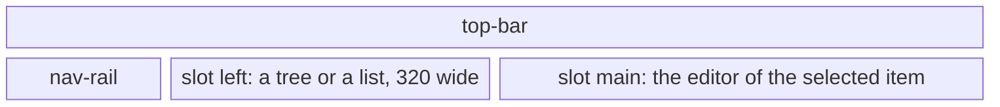

# Figma file

> [Home](../README.md) › [Design system](README.md) › Figma file

What the Figma file of the design system holds, with the ids a later session needs to go on. Kept up to date at each session that draws in it. File: [Synoptic Studio · Design System](https://www.figma.com/design/2hW8t5CgVru1VFbQZ1yETL).

## Pages

| Page | Id | Holds |
| --- | --- | --- |
| Foundations | `630:103` | The variables and styles, shown with their names. |
| Icons | `630:104` | One component per icon. |
| Atoms | `630:105` | The atoms. |
| Molecules | `630:106` | The molecules. |
| Organisms | `630:107` | The organisms. |
| Templates | `630:108` | The layout of the screens. |
| Metadata | `630:109` | The screens of Metadata. |
| Spec | `466:5` | Wireframes of the specs, drawn before the design system. Not part of the library. |
| POC · … | `5:119` and after | The old design system, for inspiration only; never changed. |

## Variables

| Collection | Id | Modes | Variables |
| --- | --- | --- | --- |
| `primitives` | `VariableCollectionId:630:111` | `value` | 37: 21 colours (`sand/`, `white`, `black`, accents), `black/a60`, 15 steps of `scale/` |
| `semantic` | `VariableCollectionId:630:149` | `sand` (`630:1`) | 49: the roles, spacing, sizes, radii and widths of [Foundations](02-foundations.md) |

The tints `blue/05` and `green/05`, and the roles `signal-input` and `signal-output`, were removed on 2026-11-22 with the background of the signal lines.

## Styles

| Kind | Styles |
| --- | --- |
| Text | `caption`, `body`, `body-strong`, `heading`, `title` (IBM Plex Sans), `code` (IBM Plex Mono) |
| Effect | `shadow-raised`, `shadow-overlay`, `focus-ring`, `focus-ring-inset` |

## How a page shows its components

Since 2026-11-22 (Product Owner: "un tableau d'états et de types [...] plutôt que plein de texte"), each component is shown as a table, with no text to read around it:

- one frame `table/<component>`, its title the name of the component;
- one column per state (`default`, `hover`, `pressed`, `focus`, `disabled`, then the states the component adds), its header the name of the state;
- one line per variant (`kind`, `size`, `checked`…), the name of each property at the head of its column of labels, its value on each line;
- the component set itself is the body of the table: its variants are laid out on the grid of the table, so the table is never out of step with the component;
- a component with no `state` shows its widest property as columns when it is narrow, else one column `preview`; a component with no variant, one cell `default`.

The tables of a page are grouped by family, one Figma section each. The frame `playground/…` of each page has its own section, `Playground`.

| Page | Sections, in order |
| --- | --- |
| Icons | `Icons`: one table per family (Parts and window, Metadata, Actions, Formatting, Signals and faceplate, Status), each icon with its name |
| Atoms | `Actions`, `Selection`, `Inputs`, `Support`, `Playground` |
| Molecules | `Forms`, `Lists and navigation`, `Table cells`, `Toolbars and window`, `Playground` |
| Organisms | `App frame`, `Lists`, `Data table`, `Editors`, `Pickers`, `Dialogs`, `Playground` |
| Templates | `Templates` |

No documentation frame and no written page per component ([Skill rules R9](skill-rules.md#r9--components-shown-as-tables-of-variants-and-states)).

## Components

The id of each component set (or component), to go on from it. Every one is prototyped (hover, press, click): try them from the frame `playground/…` of its page, a flow starting point.

| Page | Component | Id |
| --- | --- | --- |
| Foundations | specimen board | `630:203` |
| Icons | 44 icons `icon/<name>`, in the section `Icons` | `656:7343` |
| Atoms | `button` | `632:209` |
| Atoms | `icon-button` | `633:98` |
| Atoms | `checkbox` | `633:144` |
| Atoms | `radio` | `633:170` |
| Atoms | `toggle` | `633:191` |
| Atoms | `text-input` | `634:127` |
| Atoms | `number-input` | `634:288` |
| Atoms | `text-area` | `634:303` |
| Atoms | `select-trigger` | `634:430` |
| Atoms | `drag-handle` | `635:135` |
| Atoms | `label` | `635:141` |
| Atoms | `tooltip` | `635:158` |
| Atoms | `colour-swatch` | `635:167` |
| Atoms | `divider` | `635:170` |
| Atoms | `playground/atoms` | `643:2164` |
| Molecules | `field` | `637:53` |
| Molecules | `menu-item` | `637:102` |
| Molecules | `menu` | `637:103` |
| Molecules | `select` | `637:206` |
| Molecules | `segmented-control` | `637:250` |
| Molecules | `radio-group` | `637:281` |
| Molecules | `list-title` | `638:143` |
| Molecules | `nav-rail-item` | `638:205` |
| Molecules | `tree-row` | `638:784` |
| Molecules | `list-row` | `638:841` |
| Molecules | `part-item` | `638:850` |
| Molecules | `link-cell` | `638:860` |
| Molecules | `quantity-cell` | `638:871` |
| Molecules | `direction-cell` | `638:884` |
| Molecules | `toolbar-group` | `638:885` |
| Molecules | `window-controls` | `638:936` |
| Molecules | `playground/molecules` | `643:2262` |
| Organisms | `top-bar` | `640:200` |
| Organisms | `nav-rail` | `640:201` |
| Organisms | `tree` | `640:573` |
| Organisms | `part-list` | `640:574` |
| Organisms | `list-panel` | `640:651` |
| Organisms | `dialog` | `640:706` |
| Organisms | `data-table-header` | `641:352` |
| Organisms | `data-table-row` | `641:1229` |
| Organisms | `data-table` | `641:1470` |
| Organisms | `palette-picker` | `641:1471` |
| Organisms | `icon-picker` | `641:1489` |
| Organisms | `formatting-toolbar` | `642:1302` |
| Organisms | `markdown-editor` | `642:1487` |
| Organisms | `faceplate-element` | `642:1828` |
| Organisms | `playground/organisms` | `643:2487` |
| Templates | `template/editor` | `657:2` |
| Templates | `example/editor`, an instance of the template with its slots filled | `657:155` |

`data-table-row` and `data-table-header` have the columns of Signals since 2026-11-22: handle, Direction, ID, Type, Enum, Quantity / Difference, Description, delete, on lines 1120 wide. `direction-cell` has no text property: its word follows its direction.

## Templates

`template/editor` is the layout of every screen of an editor, 1600 × 900, made of instances and slots only:

- `top-bar` (`platform=windows` by default) across the whole width, then `nav-rail`, the slot `left` (width `size-left-column`), a vertical `divider`, and the slot `main` (padding and gap `spacing-06`).
- A screen is an instance of the template: its content goes into the two slots, as instances. `example/editor` shows it with the type tree and the parts on the left, the table of signals in the main area.

## Left to draw

- The page Metadata.
