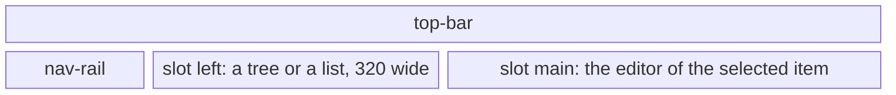

# Figma file

> [Home](../README.md) › [Design system](README.md) › Figma file

What the Figma file of the design system holds, with the ids a later session needs to go on. Kept up to date at each session that draws in it. File: [Synoptic Studio · Design System](https://www.figma.com/design/2hW8t5CgVru1VFbQZ1yETL).

## Pages

| Page | Id | Holds |
| --- | --- | --- |
| Foundations | `630:103` | The variables and styles, shown with their names. |
| Icons | `630:104` | One component per icon. |
| Atoms | `630:105` | The atoms. |
| Molecules | `630:106` | The molecules. |
| Organisms | `630:107` | The organisms. |
| Templates | `630:108` | The layout of the screens. |
| Metadata | `630:109` | The screens of Metadata. |
| Spec | `466:5` | Wireframes of the specs, drawn before the design system. Not part of the library. |
| POC · … | `5:119` and after | The old design system, for inspiration only; never changed. |

## Variables

| Collection | Id | Modes | Variables |
| --- | --- | --- | --- |
| `primitives` | `VariableCollectionId:630:111` | `value` | 43: 23 colours (`sand/25` and `sand/30` added on 2026-11-22 for the hover) (`sand/`, `white`, `black`, accents), `black/a60`, the veils `black/a00`, `black/a07`, `black/a13`, `black/a17` (2026-11-22, aliased by `layer-transparent`, `layer-hover`, `layer-pressed`, `layer-active`), 15 steps of `scale/` |
| `semantic` | `VariableCollectionId:630:149` | `sand` (`630:1`) | 51 (`layer-active` and `layer-transparent` added on 2026-11-22): the roles, spacing, sizes, radii and widths of [Foundations](02-foundations.md) |

The effect style `focus-ring` does not show behind its node (`showShadowBehindNode` false): behind a transparent veil, its light line made the whole control look light (2026-11-22). `menu` is 280 high at most and scrolls inside.

A colour bound to a variable takes its opacity from the variable: a fill bound to `layer-hover` set to 0 % still shows at 7 %. A transparent start needs its own variable (`layer-transparent`).

The tints `blue/05` and `green/05`, and the roles `signal-input` and `signal-output`, were removed on 2026-11-22 with the background of the signal lines.

## Styles

| Kind | Styles |
| --- | --- |
| Text | `caption`, `body`, `body-strong`, `heading`, `title` (IBM Plex Sans), `code` (IBM Plex Mono) |
| Effect | `shadow-raised`, `shadow-overlay`, `focus-ring`, `focus-ring-inset` |

## How a page shows its components

Since 2026-11-22 (Product Owner: "un tableau d'états et de types [...] plutôt que plein de texte"), each component is shown as a table, with no text to read around it:

- one frame `table/<component>`, its title the name of the component;
- one column per state (`default`, `hover`, `pressed`, `focus`, `disabled`, then the states the component adds), its header the name of the state;
- one line per variant (`kind`, `size`, `checked`…), the name of each property at the head of its column of labels, its value on each line;
- the component set itself is the body of the table: its variants are laid out on the grid of the table, so the table is never out of step with the component;
- a component with no `state` shows its widest property as columns when it is narrow, else one column `preview`; a component with no variant, one cell `default`.

The tables of a page are grouped by family, one Figma section each. The frame `playground/…` of each page has its own section, `Playground`.

| Page | Sections, in order |
| --- | --- |
| Icons | `Icons`: one table per family (Parts and window, Metadata, Actions, Formatting, Signals and faceplate, Status), each icon with its name; every table six cells wide with a border on its four sides, three tables a row |
| Atoms | `Actions`, `Selection`, `Inputs`, `Support`, `Playground` |
| Molecules | `Forms`, `Lists and navigation`, `Table cells`, `Toolbars and window`, `Playground` |
| Organisms | `App frame`, `Lists`, `Data table`, `Editors`, `Pickers`, `Dialogs`, `Playground` |
| Templates | `Templates` |

No documentation frame and no written page per component ([Skill rules R9](skill-rules.md#r9--components-shown-as-tables-of-variants-and-states)).

## Components

The id of each component set (or component), to go on from it. Every one is prototyped (hover, press, click): try them from the frame `playground/…` of its page, a flow starting point.

| Page | Component | Id |
| --- | --- | --- |
| Foundations | specimen board | `630:203` |
| Icons | 46 icons `icon/<name>`, in the section `Icons`; `folder-add` (`673:13125`) and `link-add` (`673:13131`) since 2026-11-22, then `signal-add` (`680:12952`), `command-add` (`680:12964`), `title-add` (`680:12974`), `description-add` (`680:12985`, renamed from `paragraph-add`, as `paragraph` became `description`, on 2026-11-22) and `group-add` (`680:12997`), `expand-all` (`699:13751`) and `collapse-all` (`699:13755`); 53 icons | `656:7343` |
| Atoms | `button` | `632:209` |
| Atoms | `icon-button` | `633:98` |
| Atoms | `checkbox` | `633:144` |
| Atoms | `radio` | `633:170` |
| Atoms | `toggle` | `633:191` |
| Atoms | `text-input` | `634:127` |
| Atoms | `number-input` | `634:288` |
| Atoms | `text-area` | `634:303` |
| Atoms | `select-trigger` | `634:430` |
| Atoms | `drag-handle` | `635:135` |
| Atoms | `label` | `635:141` |
| Atoms | `tooltip` | `635:158` |
| Atoms | `colour-swatch` | `635:167` |
| Atoms | `divider` | `635:170` |
| Atoms | `column-header` | `664:6368` |
| Atoms | `toggle-button` | `684:2199` |
| Atoms | `table/toggle-button` | `701:20082` (the table, in the section `Actions`) |
| Atoms | `scrollbar` | `706:717`, in its table `706:719` (section `Support`) |
| Atoms | `playground/atoms` | `643:2164` |
| Molecules | `field` | `637:53` |
| Molecules | `menu-item` | `637:102` |
| Molecules | `menu` | `637:103` |
| Molecules | `select` | `637:206` |
| Molecules | `menu-group-title` | `706:736`, in its table `706:790` (section `Forms`) |
| Molecules | `menu-grouped` | `706:738`, in its table `706:856` (section `Forms`); 280 high, clips and scrolls vertically |
| Molecules | `segmented-control` | `637:250` |
| Molecules | `radio-group` | `637:281` |
| Molecules | `list-title` | `638:143` |
| Molecules | `nav-rail-item` | `638:205` |
| Molecules | `tree-row` | `638:784` |
| Molecules | `list-row` | `638:841` |
| Molecules | `part-item` | `638:850` |
| Molecules | `link-cell` | `638:860` |
| Molecules | `quantity-cell` | `638:871` |
| Molecules | `direction-cell` | `638:884` |
| Molecules | `toolbar-group` | `638:885` |
| Molecules | `window-controls` | `638:936` |
| Molecules | `table-size-picker` | `684:2760`, in its table `701:20176` (section `Toolbars and window`) |
| Molecules | `playground/molecules` | `643:2262` |
| Organisms | `top-bar` | `640:200` |
| Organisms | `nav-rail` | `640:201` |
| Organisms | `tree` | `640:573` |
| Organisms | `part-list` | `640:574` |
| Organisms | `list-panel` | `640:651` |
| Organisms | `dialog` | `640:706` |
| Organisms | `data-table-header` | `641:352` |
| Organisms | `data-table-row` | `641:1229` |
| Organisms | `data-table` | `641:1470` |
| Organisms | `palette-picker` | `641:1471` |
| Organisms | `icon-picker` | `641:1489` |
| Organisms | `formatting-toolbar` | `642:1302` |
| Organisms | `markdown-editor` | `642:1487` |
| Organisms | `faceplate-element` | `642:1828` |
| Organisms | `playground/organisms` | `643:2487` |
| Templates | `template/editor` | `657:2` |
| Templates | `example/editor`, an instance of the template with its slots filled | `657:155` |

`data-table-row` holds its cells in the slot `cells`, and `data-table-header` its column headers in the slot `columns`: a screen puts in them the columns of its table, each cell as wide as its `column-header`. Their default content is the columns of Signals. `data-table` has the corners `radius-md` and the padding `spacing-04` at the top and the bottom: the add button of its title and the delete button of its last line are 16 from the edges, as on the sides. `quantity-cell` and `direction-cell` are deprecated: their description says what replaces them. `data-table-row` has no line under it and its states are `default`, `hover` and `dragging` (no `dragging` for `kind=inherited`); in the prototype, only pressing its handle shows the line `dragging`; a click on the line itself does nothing (Product Owner, 2026-11-22: "la ligne, je suis pas censé pouvoir la cliquer"). A `text-input` or `number-input` `filled` takes the focus on a click and gives it back on a second click. In the formatting tool bar, a click on the table button turns it `selected` and opens its grid. In `faceplate-element` `kind=group`, the slot `actions` and the delete sit in the frame `buttons` (gap `spacing-02`), so the delete is one more button of the row; after such a change of structure, an instance may draw the old positions until its main component's frame is touched again (a padding set then reset).

`list-title` has the variants `actions=tree` (`699:14056`, searching `699:14060`), used by `tree`. `nav-rail-item` holds a hidden `tooltip` in every variant and shows it in `state=tooltip` (rail `701:34`, top bar `701:41`): while hovering it goes to `hover`, and a mouse enter of 0.8 s leads to `tooltip`; the rail items of the screens carry the same two reactions next to their click. The texts are set in `nav-rail` and `top-bar`. A selected item, line or part has no reaction of its own (2026-11-22: 51 instances cleared). `template/editor` and its `body` draw their first child on top (`itemReverseZIndex`), so that the rail and the top bar show their tooltips over the columns. A script that looks for a hidden layer inside an instance sets `figma.skipInvisibleInstanceChildren = false` first: the plugin API hides them by default.

No frame or slot without a fill clips its content, in the components and on the screens (2026-11-22, 124 frames changed): the focus line of a field at the edge of its frame showed cut. Only the surfaces with a fill clip (a table, a panel, a screen, an overlay).

An instance given a click of its own (open an overlay, go to a screen) loses the hover of its component unless it is set again with it: on 2026-11-22, 160 instances got their hover back (Delete the type, the buttons of the warning, the rail...). Any new click is set next to the hover, never in its place.

An icon swapped into a `button` or an `icon-button` keeps only the colour overrides of the lines its default icon has (`icon/add` has two): every line of the new icon gets the colour of its variant by hand, the label's colour in a `button` (fixed on 2026-11-22: the delete icon of a danger button was half white, half black).

An instance nested in another one keeps the size of its main component: in a screen, a column gets its width only as the content of a slot. After a script fills a slot, Figma may draw a cell that fills its line at its old width: setting it to a fixed width, then back to fill, draws it right.

## Templates

`template/editor` is the layout of every screen of an editor, 1600 × 900, made of instances and slots only:

- `top-bar` (`platform=windows` by default) across the whole width, then `nav-rail`, the slot `left` (width `size-left-column`), a vertical `divider`, and the slot `main` (padding and gap `spacing-06`).
- A screen is an instance of the template: its content goes into the two slots, as instances. `example/editor` shows it with the type tree and the parts on the left, the table of signals in the main area.

## Screens of Metadata

The page Metadata holds one Figma section per screen of [Screens of Metadata](../screens/metadata.md), from top to bottom in the order of the type and of the rail (Product Owner, 2026-11-22): General (with the type tree), Documentation, Signals, Commands, Flags, Presets, Units, Enums, Designations, then the overlays (Delete warning, Add a link, Formatting). Each screen is an instance of `template/editor`, named `MD-xx · <screen>`, then `· <state>` for each content state. In the left column of the 25 screens with the type tree, and of `example/editor`, a `divider` separates the tree from the parts (MD-01.8).

| Section | Id | Frames |
| --- | --- | --- |
| MD-01 · Types and MD-02 · General | `667:6125` | General (`667:6126`), error, long text; Types: many, searching, empty |
| MD-03 · Documentation | `667:9805` | visual (`667:10608`), markdown, full page, no link, long text; no read only (removed on 2026-11-22) |
| MD-03 · Formatting | `684:14751` | `MD-03 · Heading level` (`684:14752`), the list of the heading select; `MD-03 · Insert a table` (`684:14867`), the grid of the table button. Each is a transparent frame of the size of the screen, its content right under its button, closed by a click anywhere: the plugin API cannot set the place of an overlay, and a centred overlay showed in the middle of the page |
| MD-03 · Add a link | `679:15292` | `MD-03 · Add a URL` (`679:15293`), the overlay of the URL icon; `MD-03 · Add a path · window of the computer` (`679:15322`), a stand-in for the system's window, opened by the path icon |
| MD-04 · Signals | `665:4990` | default (`665:4991`), empty, many, long text, error |
| MD-05 · Commands | `666:3777` | default (`666:3778`), empty, error |
| MD-12 · Flags | `666:6541` | default (`666:6542`), empty, error |
| MD-07 · Presets | `668:9609` | Values (`668:9610`), Faceplate (`668:11695`), empty, error; `MD-07 · Display unit` (`706:13686`), the grouped list the display unit `bar` of `pressure_out` opens, a transparent frame of the screen's size like the lists of MD-03. In Faceplate, every signal in write is on two lines |
| MD-08 · Units | `669:11672` | Mass in Imperial (`669:11673`), Temperature in Imperial (`669:13261`, with its switch Quantity or Difference); the quantities are a `list-panel` of `list-row` with their icons since 2026-11-22 |
| MD-09 · Enums | `669:14179` | global (`669:14180`), template (`669:15030`: the same enum `pump_mode`, its Items table empty with its message), empty, error; Global and Template lead from one to the other |
| MD-13 · Designations | `666:8401` | default (`666:8402`), empty, error |
| Delete warning | `670:13025` | `MD-02 · Delete warning` (`670:13026`), the frame the delete buttons open as an overlay |

The prototype has one starting point per screen (Product Owner, 2026-11-22: "je peux pas faire play sur toutes les pages"): General, Documentation, Signals, Commands, Flags, Presets, Units, Enums, Designations. On every screen, the rail and the list of the parts lead to their screen, with their hover kept. From General: the rail, the list of the parts, the modes of the documentation and of a preset lead to their screen; the two add icons of Links open their overlay; the button "Delete the preset" opens the warning; the delete button of General and of each own signal opens the warning, whose two buttons close it. The dimmed background behind the warning is set by hand in Figma (the plugin API cannot set it).

## Left to draw

- The screens of the other parts: Symbols, Pipes, Synoptic.
