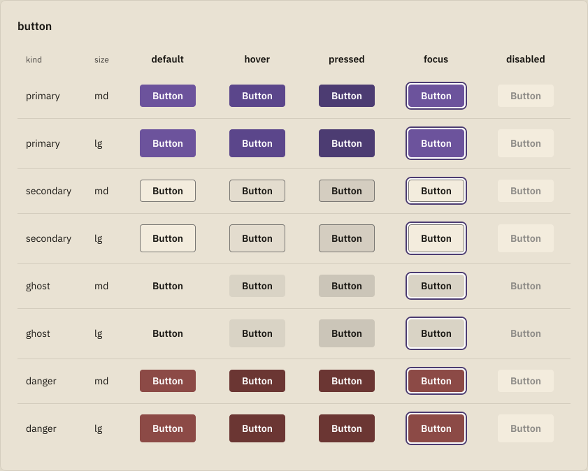

# button

> [Home](../../README.md) › [Design system](../README.md) › [Atoms](README.md) › button

A text button that starts an action named with words: Cancel, Delete, Delete the type. An action shown by an icon alone is an [icon-button](icon-button.md).

## Figma

| Node | Id |
| --- | --- |
| Component set | [`632:209`](https://www.figma.com/design/2hW8t5CgVru1VFbQZ1yETL/?node-id=632-209) |

## Variants and states

## Inputs

| Input | Type | Default | Figma |
| --- | --- | --- | --- |
| `label` | text | `Button` | text property `label` |
| `kind` | `primary`, `secondary`, `ghost`, `danger` | `primary` | variant `kind` |
| `size` | `md`, `lg` | `md` | variant `size` |
| `icon` | icon name | none | boolean `leading-icon` and instance swap `icon` |
| `disabled` | boolean | `false` | `state=disabled` |

## Outputs

| Output | When | Value |
| --- | --- | --- |
| `click` | A click, or Enter or Space while it has the focus. | — |

## Behaviour

- `hover`, `pressed` and `focus` come from the mouse and the keyboard, never from an input.
- A `danger` button deletes; it is the only red button of a screen.
- The icon takes the colour of the label: every line of an icon swapped in is recoloured with it.
- The stroke never moves the label: it is drawn over the padding.
