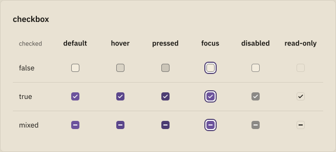

# checkbox

> [Home](../../README.md) › [Design system](../README.md) › [Atoms](README.md) › checkbox

A box that turns an option on or off, alone or for a line among many. Two to five exclusive options are a [radio-group](../07-molecules/radio-group.md).

## Figma

| Node | Id |
| --- | --- |
| Component set | [`633:144`](https://www.figma.com/design/2hW8t5CgVru1VFbQZ1yETL/?node-id=633-144) |

## Variants and states

## Inputs

| Input | Type | Default | Figma |
| --- | --- | --- | --- |
| `checked` | `false`, `true`, `mixed` | `false` | variant `checked` |
| `label` | text | — | none: its accessible name, or the text next to it |
| `disabled` | boolean | `false` | `state=disabled` |

## Outputs

| Output | When | Value |
| --- | --- | --- |
| `checkedChange` | A click, or Space while it has the focus. | the new value: `true` or `false` (`mixed` is never chosen by a click) |

## Behaviour

- A click in focus goes to the next value in `default`, the state that has the hover.
