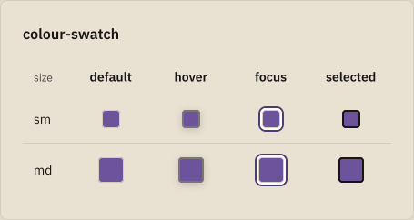

# colour-swatch

> [Home](../../README.md) › [Design system](../README.md) › [Atoms](README.md) › colour-swatch

A sample of a colour of the palette, to pick it as the colour of a type.

## Figma

| Node | Id |
| --- | --- |
| Component set | [`635:167`](https://www.figma.com/design/2hW8t5CgVru1VFbQZ1yETL/?node-id=635-167) |

## Variants and states

## Inputs

| Input | Type | Default | Figma |
| --- | --- | --- | --- |
| `colour` | colour of the palette | — | the fill of its instance |
| `name` | text | — | none: the accessible name |
| `size` | `sm`, `md` | `sm` | variant `size` |
| `selected` | boolean | `false` | `state=selected` |

## Outputs

| Output | When | Value |
| --- | --- | --- |
| `select` | A click, or Enter or Space, on a swatch not selected. | — |

## Behaviour

- `hover`: a 2 px `border-strong` line (grey) and `shadow-raised`, so that it is seen.
- `selected`: a 2 px `text-primary` line (near black), no shadow, so that it never looks like the hover. A selected swatch does not react to the mouse.
