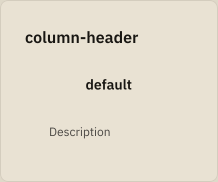

# column-header

> [Home](../../README.md) › [Design system](../README.md) › [Atoms](README.md) › column-header

The name of a column at the head of a table. Its width is the width of its column.

## Figma

| Node | Id |
| --- | --- |
| Component | [`664:6368`](https://www.figma.com/design/2hW8t5CgVru1VFbQZ1yETL/?node-id=664-6368) |

## Variants and states

## Inputs

| Input | Type | Default | Figma |
| --- | --- | --- | --- |
| `label` | text | `Description` | text property `label` |
| `width` | the width of the column | — | set on the instance |

## Outputs

None.
