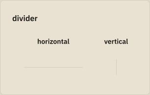

# divider

> [Home](../../README.md) › [Design system](../README.md) › [Atoms](README.md) › divider

A thin line that separates groups of content.

## Figma

| Node | Id |
| --- | --- |
| Component set | [`635:170`](https://www.figma.com/design/2hW8t5CgVru1VFbQZ1yETL/?node-id=635-170) |

## Variants and states

## Inputs

| Input | Type | Default | Figma |
| --- | --- | --- | --- |
| `direction` | `horizontal`, `vertical` | `horizontal` | variant `direction` |

## Outputs

None.
