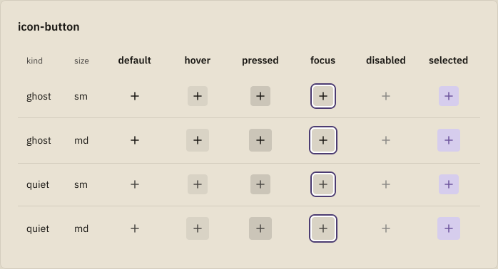

# icon-button

> [Home](../../README.md) › [Design system](../README.md) › [Atoms](README.md) › icon-button

A square button that shows one icon, for a frequent action: the + of a title, delete on a line, reset, search, full page. It always has an accessible name and a [tooltip](tooltip.md).

## Figma

| Node | Id |
| --- | --- |
| Component set | [`633:98`](https://www.figma.com/design/2hW8t5CgVru1VFbQZ1yETL/?node-id=633-98) |

## Variants and states

## Inputs

| Input | Type | Default | Figma |
| --- | --- | --- | --- |
| `icon` | icon name | `add` | instance swap `icon` |
| `label` | text | — | none: the accessible name and the text of the tooltip |
| `kind` | `ghost`, `quiet` | `ghost` | variant `kind` |
| `size` | `sm`, `md` | `sm` | variant `size` |
| `selected` | boolean | `false` | `state=selected` |
| `disabled` | boolean | `false` | `state=disabled` |

## Outputs

| Output | When | Value |
| --- | --- | --- |
| `click` | A click, or Enter or Space while it has the focus. | — |

## Behaviour

- `quiet` draws its icon in `icon-secondary`; it is the + that shows on a line in hover.
- `ghost` and `quiet` have the same hover (`layer-hover`) and press (`layer-pressed`): on a line already in hover the two veils add up, so the button still shows.
- `selected` is used while what the button opens stays open (the table button of the formatting tool bar).
