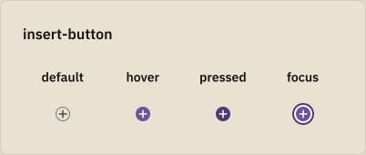

# insert-button

> [Home](../../README.md) › [Design system](../README.md) › [Atoms](README.md) › insert-button

A small round + that inserts a line or a column of a table of a description. It shows only while the mouse is on the table, at the limit nearest to the mouse: between two lines, between two columns, under the table or on its right ([content-table](../07-molecules/content-table.md)).

## Figma

| Node | Id |
| --- | --- |
| Component set | [`732:243`](https://www.figma.com/design/2hW8t5CgVru1VFbQZ1yETL/?node-id=732-243) |

## Variants and states

## Inputs

None: where it inserts is given by its place in the table.

## Outputs

| Output | When | Value |
| --- | --- | --- |
| `insert` | A click, or Enter or Space while it has the focus. | — |

## Behaviour

- 16 px round, `layer-01` with a `border-strong` line at rest, so that it shows on the table and on the page; `accent` under the mouse, `accent-pressed` while pressed, its + in `text-on-accent`.
- Proposed by the assistant (2026-11-23), to review on screen.

## Made of

| Component | Role |
| --- | --- |
| [Icons](../05-icons/README.md) | `icon/add`, at 12 px. |
