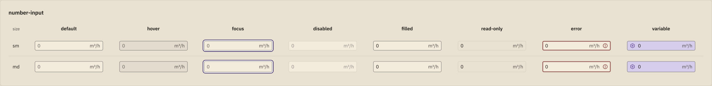

# number-input

> [Home](../../README.md) › [Design system](../README.md) › [Atoms](README.md) › number-input

A field for a number, with its unit, or a value taken from a signal or a designation. Its behaviour is the one of [Number and text fields](../../controls/number-and-text-fields.md).

## Figma

| Node | Id |
| --- | --- |
| Component set | [`634:288`](https://www.figma.com/design/2hW8t5CgVru1VFbQZ1yETL/?node-id=634-288) |

## Variants and states

## Inputs

| Input | Type | Default | Figma |
| --- | --- | --- | --- |
| `value` | number | empty | text property `value`; `state=filled` when not empty |
| `unit` | text | none | text property `unit`, boolean `show-unit` |
| `variable` | the ID of a signal or a designation | none | `state=variable`: the value comes from it, shown with the icon `variable` |
| `size` | `sm`, `md` | `sm` | variant `size` |
| `readOnly` | boolean | `false` | `state=read-only` |
| `error` | text | none | `state=error` |
| `disabled` | boolean | `false` | `state=disabled` |

## Outputs

| Output | When | Value |
| --- | --- | --- |
| `valueChange` | The value is validated: Enter, or the field loses the focus. | the new number |
| `variableChange` | A signal or a designation is chosen in place of a value, or removed. | its ID, or none |

## Behaviour

- No `pressed`: a click puts it in `focus`; a second click takes the focus back, to `default`.
- The unit stays at the right, in `text-secondary`; the number is never hidden under it.
