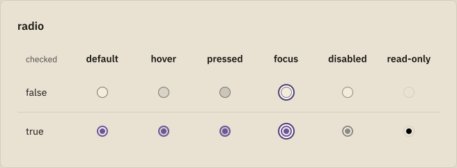

# radio

> [Home](../../README.md) › [Design system](../README.md) › [Atoms](README.md) › radio

A round button to pick one option of a small exclusive set. Never alone: always in a [radio-group](../07-molecules/radio-group.md).

## Figma

| Node | Id |
| --- | --- |
| Component set | [`633:170`](https://www.figma.com/design/2hW8t5CgVru1VFbQZ1yETL/?node-id=633-170) |

## Variants and states

## Inputs

| Input | Type | Default | Figma |
| --- | --- | --- | --- |
| `checked` | boolean | `false` | variant `checked` |
| `disabled` | boolean | `false` | `state=disabled` |
| `readOnly` | boolean | `false` | `state=read-only` |

## Outputs

| Output | When | Value |
| --- | --- | --- |
| `select` | A click, or Space while it has the focus, on a radio not checked. | — |

## Behaviour

- A checked radio is not unchecked by a click: another radio of its group is chosen instead.
- `read-only` (2026-11-24): the value of something the user cannot change here, such as an element inherited from a parent type. It stays legible, never greyed as `disabled` is: no fill of its own (`layer-transparent`), a ring `icon-secondary`, a dot `icon-primary`; a click does nothing.
