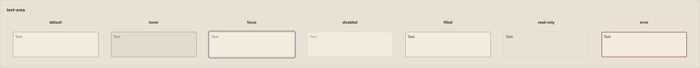

# text-area

> [Home](../../README.md) › [Design system](../README.md) › [Atoms](README.md) › text-area

A field of several lines, for a description.

## Figma

| Node | Id |
| --- | --- |
| Component set | [`634:303`](https://www.figma.com/design/2hW8t5CgVru1VFbQZ1yETL/?node-id=634-303) |

## Variants and states

## Inputs

| Input | Type | Default | Figma |
| --- | --- | --- | --- |
| `value` | text | empty | text property `value`; `state=filled` when not empty |
| `placeholder` | text | — | the text of `state=default` |
| `readOnly` | boolean | `false` | `state=read-only` |
| `error` | text | none | `state=error` |
| `disabled` | boolean | `false` | `state=disabled` |

## Outputs

| Output | When | Value |
| --- | --- | --- |
| `valueChange` | The field loses the focus. | the new text |

## Behaviour

- Enter goes to a new line; the value is validated when the field loses the focus.
- No `pressed`: a click puts it in `focus`.
