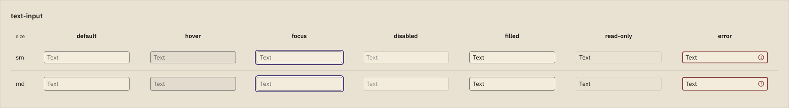

# text-input

> [Home](../../README.md) › [Design system](../README.md) › [Atoms](README.md) › text-input

A field of one line to type a text: an ID, a name, a path. Its behaviour is the one of [Number and text fields](../../controls/number-and-text-fields.md).

## Figma

| Node | Id |
| --- | --- |
| Component set | [`634:127`](https://www.figma.com/design/2hW8t5CgVru1VFbQZ1yETL/?node-id=634-127) |

## Variants and states

## Inputs

| Input | Type | Default | Figma |
| --- | --- | --- | --- |
| `value` | text | empty | text property `value`; `state=filled` when not empty |
| `placeholder` | text | — | the text of `state=default` |
| `size` | `sm`, `md` | `sm` | variant `size` (`sm` in a table cell) |
| `icon` | icon name | none | boolean `trailing-icon` and instance swap `icon` |
| `readOnly` | boolean | `false` | `state=read-only` |
| `error` | text | none | `state=error`: the message is shown by its [field](../07-molecules/field.md) or its line |
| `disabled` | boolean | `false` | `state=disabled` |

## Outputs

| Output | When | Value |
| --- | --- | --- |
| `valueChange` | The value is validated: Enter, or the field loses the focus. | the new text |
| `iconClick` | A click on the trailing icon. | — |

## Behaviour

- No `pressed`: a click puts it in `focus`; a second click takes the focus back, to `default`.
- A text too long for the field ends with "…" when it does not have the focus.
- The 2 px line of `error` is drawn over the padding: the text never moves.
