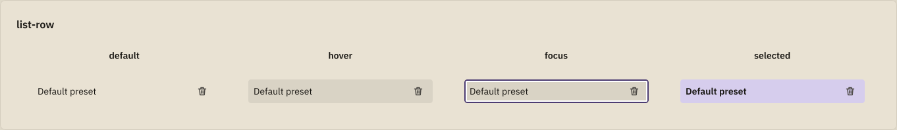

# list-row

> [Home](../../README.md) › [Design system](../README.md) › [Molecules](README.md) › list-row

A line of a list: a name, where it comes from when needed, its icons `quantity` and `difference` when needed, its duplicate button and its delete button.

## Figma

| Node | Id |
| --- | --- |
| Component set | [`638:841`](https://www.figma.com/design/2hW8t5CgVru1VFbQZ1yETL/?node-id=638-841) |

## Variants and states

## Inputs

| Input | Type | Default | Figma |
| --- | --- | --- | --- |
| `name` | text | — | text property `name` |
| `source` | text | none | text property `source`, shown with the boolean `with-source`: in `text-secondary` after the name, the `id` of the parent a line comes from; used by no screen since the presets were removed (2026-11-24) |
| `duplicable` | boolean | `false` | boolean `with-duplicate`: an [icon-button](../06-atoms/icon-button.md) `duplicate` before the delete button |
| `deletable` | boolean | `true` | boolean `with-delete` |
| `quantity`, `difference` | boolean | `false` | booleans `quantity-icon`, `difference-icon` |
| `selected` | boolean | `false` | `state=selected` |

## Outputs

| Output | When | Value |
| --- | --- | --- |
| `select` | A click on a line not selected, or Enter. | — |
| `duplicate` | A click on duplicate. | — |
| `delete` | A click on delete. | — |

## Behaviour

- A selected line does not react to the mouse.
- The duplicate button shows on hover and on focus only; elsewhere its place stays empty, so the line does not move when it shows. Drawn for the Parent presets, removed on 2026-11-24: no screen uses it now.

## Made of

| Component | Role |
| --- | --- |
| [Icons](../05-icons/README.md) | quantity, difference. |
| [icon-button](../06-atoms/icon-button.md) | Duplicate, delete. |
