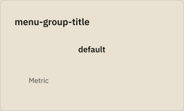

# menu-group-title

> [Home](../../README.md) › [Design system](../README.md) › [Molecules](README.md) › menu-group-title

The small title of a group of items in a menu: text `caption`, `text-secondary`, padding `spacing-03` and `spacing-02` under it.

## Figma

| Node | Id |
| --- | --- |
| Component | [`706:736`](https://www.figma.com/design/2hW8t5CgVru1VFbQZ1yETL/?node-id=706-736) |

## Variants and states

## Inputs

| Input | Type | Default | Figma |
| --- | --- | --- | --- |
| `text` | text | — | its text |

## Outputs

None: it cannot be chosen.
