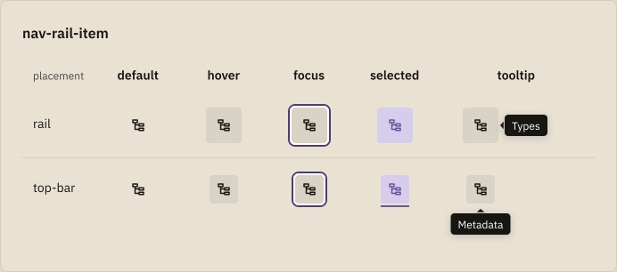

# nav-rail-item

> [Home](../../README.md) › [Design system](../README.md) › [Molecules](README.md) › nav-rail-item

An icon that opens a page: of a part in the rail, or a part of the application in the top bar. An [icon-button](../06-atoms/icon-button.md) and its hidden [tooltip](../06-atoms/tooltip.md).

## Figma

| Node | Id |
| --- | --- |
| Component set | [`638:205`](https://www.figma.com/design/2hW8t5CgVru1VFbQZ1yETL/?node-id=638-205) |
| Variant `placement=rail`, `state=tooltip` | [`701:34`](https://www.figma.com/design/2hW8t5CgVru1VFbQZ1yETL/?node-id=701-34) |
| Variant `placement=top-bar`, `state=tooltip` | [`701:41`](https://www.figma.com/design/2hW8t5CgVru1VFbQZ1yETL/?node-id=701-41) |
| Variant `placement=rail`, `state=disabled` | [`759:3872`](https://www.figma.com/design/2hW8t5CgVru1VFbQZ1yETL/?node-id=759-3872) |

## Variants and states

The table does not show `state=disabled` yet, added on 2026-11-23 for the arrows of the symbol mode.

## Inputs

| Input | Type | Default | Figma |
| --- | --- | --- | --- |
| `icon` | icon name | — | the icon of its button |
| `label` | text | — | the text of its tooltip, and its accessible name |
| `placement` | `rail`, `top-bar` | `rail` | variant `placement` |
| `selected` | boolean | `false` | `state=selected` |
| `disabled` | boolean | `false` | `state=disabled`, placement rail only: its [icon-button](../06-atoms/icon-button.md) in `state=disabled` |

## Outputs

| Output | When | Value |
| --- | --- | --- |
| `click` | A click, or Enter or Space, on an item not selected. | — |

## Behaviour

- In the rail: a square of `size-control-lg`. In the top bar: a square of `size-top-bar`, a `size-control-md` button with the same margin on every side.
- `selected`: the `layer-selected` background; in the top bar, a bar of `accent` under it too. A selected item does not react to the mouse.
- `disabled`: greyed, no tooltip, does not react to the mouse nor take the focus; used for an arrow of a list cut into parts that leads nowhere ([SY-00.5](../../screens/symbols.md#sy-00--navigation-bar-of-the-symbol-mode)).
- After 0.8 s of hover, `tooltip`: the name of the page, on the right in the rail, under it in the top bar, centred on the icon (MD-00.8).

## Made of

| Component | Role |
| --- | --- |
| [icon-button](../06-atoms/icon-button.md) | The button and its icon. |
| [tooltip](../06-atoms/tooltip.md) | The name of the page, after 0.8 s. |
