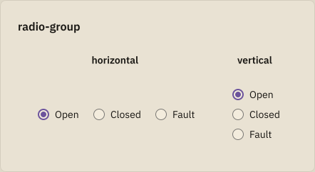

# radio-group

> [Home](../../README.md) › [Design system](../README.md) › [Molecules](README.md) › radio-group

[Radios](../06-atoms/radio.md) and their labels laid out together, one checked.

## Figma

| Node | Id |
| --- | --- |
| Component set | [`637:281`](https://www.figma.com/design/2hW8t5CgVru1VFbQZ1yETL/?node-id=637-281) |

## Variants and states

## Inputs

| Input | Type | Default | Figma |
| --- | --- | --- | --- |
| `options` | two to five texts | — | the labels of its radios |
| `value` | the checked option | the first | the radio in `checked=true` |
| `orientation` | `horizontal`, `vertical` | `horizontal` | variant `orientation` |
| `disabled` | boolean | `false` | its radios in `state=disabled` |

## Outputs

| Output | When | Value |
| --- | --- | --- |
| `valueChange` | A click on another option, or the arrows inside the group. | the option |

## Made of

| Component | Role |
| --- | --- |
| [radio](../06-atoms/radio.md) | Each option. |
