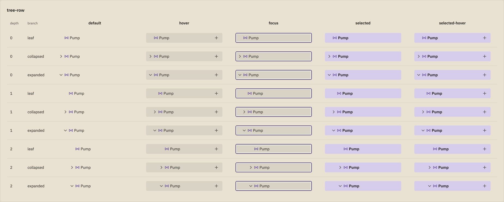

# tree-row

> [Home](../../README.md) › [Design system](../README.md) › [Molecules](README.md) › tree-row

A line of the type tree: chevron, the icon of the type in its colour, its name, and a quiet + on hover to add a sub-type.

## Figma

| Node | Id |
| --- | --- |
| Component set | [`638:784`](https://www.figma.com/design/2hW8t5CgVru1VFbQZ1yETL/?node-id=638-784) |

## Variants and states

## Inputs

| Input | Type | Default | Figma |
| --- | --- | --- | --- |
| `name` | text | — | text property `name` |
| `icon`, `colour` | the icon and the colour of the type | — | the type icon of its instance |
| `depth` | 0, 1, 2… | 0 | variant `depth` (three drawn) |
| `branch` | `leaf`, `collapsed`, `expanded` | `leaf` | variant `branch` |
| `selected` | boolean | `false` | `state=selected` |

## Outputs

| Output | When | Value |
| --- | --- | --- |
| `select` | A click on a line not selected, or Enter. | — |
| `toggle` | A click on the chevron, or the left and right arrows. | the new `branch` |
| `addChild` | A click on the +. | — |

## Behaviour

- On hover the + shows on the right. A selected line keeps that hover: it shows its + without any other change, `state=selected-hover`. A click on a selected line does nothing.
- The chevron still opens and closes a selected line.
- A long name ends with "…".

## Made of

| Component | Role |
| --- | --- |
| [Icons](../05-icons/README.md) | The chevron, the icon of the type. |
| [icon-button](../06-atoms/icon-button.md) | The quiet + on hover. |
