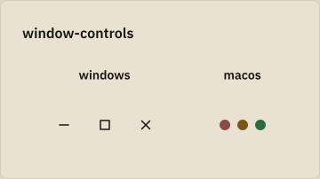

# window-controls

> [Home](../../README.md) › [Design system](../README.md) › [Molecules](README.md) › window-controls

Minimise, maximise or restore, and close, of the application window, drawn the way of its system.

## Figma

| Node | Id |
| --- | --- |
| Component set | [`638:936`](https://www.figma.com/design/2hW8t5CgVru1VFbQZ1yETL/?node-id=638-936) |

## Variants and states

## Inputs

| Input | Type | Default | Figma |
| --- | --- | --- | --- |
| `platform` | `windows`, `macos` | `windows` | variant `platform` |
| `maximised` | boolean | `false` | the middle button shows `maximise` or `restore` |

## Outputs

| Output | When | Value |
| --- | --- | --- |
| `minimise`, `maximise`, `restore`, `close` | A click on its button. | — |

## Behaviour

- In a browser there are no window controls: the [top-bar](../08-organisms/top-bar.md) `browser` has none.

## Made of

| Component | Role |
| --- | --- |
| [Icons](../05-icons/README.md) | minimise, maximise, close. |
