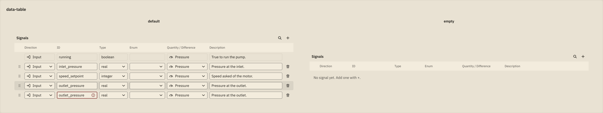

# data-table

> [Home](../../README.md) › [Design system](../README.md) › [Organisms](README.md) › data-table

A titled table: a [list-title](../07-molecules/list-title.md), a [data-table-header](data-table-header.md) and its [data-table-row](data-table-row.md) lines, on `layer-01` with the corners `radius-md`.

## Figma

| Node | Id |
| --- | --- |
| Component set | [`641:1470`](https://www.figma.com/design/2hW8t5CgVru1VFbQZ1yETL/?node-id=641-1470) |

## Variants and states

## Inputs

| Input | Type | Default | Figma |
| --- | --- | --- | --- |
| `title` | text, or none | — | its list-title |
| `columns` | list: name, width | the columns of Signals | its data-table-header |
| `rows` | list of lines | — | slot `rows`, filled with data-table-row |
| `empty` | text | — | `state=empty`: the message of an empty table |

## Outputs

| Output | When | Value |
| --- | --- | --- |
| `add` | The + of the title. | — |
| `rowChange`, `rowDelete`, `rowMove` | From its lines. | the line |

## Behaviour

- Padding `spacing-04` at the top and the bottom, `spacing-03` on the sides: the buttons of its corners sit 16 from each edge.
- A table with no title (Units): `spacing-03` at the top and `spacing-04` at the bottom, its fields 16 from every edge.
- A read-only table uses lines `kind=inherited`: they light on hover, to read them, but nothing happens on a click.
- Wider than its panel, it scrolls with a horizontal [scrollbar](../06-atoms/scrollbar.md).

## Made of

| Component | Role |
| --- | --- |
| [list-title](../07-molecules/list-title.md) | Its title and its +. |
| [data-table-header](data-table-header.md) | The column headers. |
| [data-table-row](data-table-row.md) | Each line, in the slot rows. |
| [scrollbar](../06-atoms/scrollbar.md) | When wider than its panel. |
