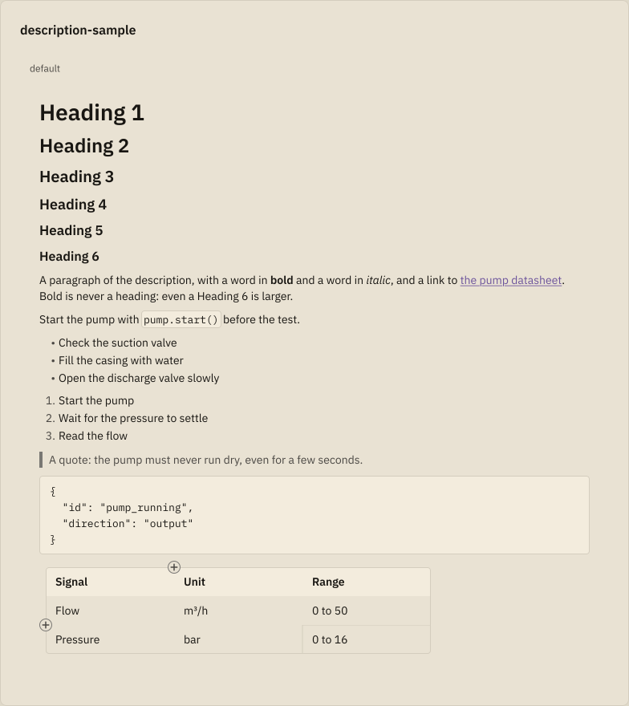

# description-sample

> [Home](../../README.md) › [Design system](../README.md) › [Organisms](README.md) › description-sample

Sample content of a description, to show how the visual editor draws what a user writes: Heading 1 to 6, a paragraph with a bold word, an italic word and a link, inline code, a bulleted list, a numbered list, a quote, a code block, and a table under the mouse. Not a control: the content of the [markdown-editor](markdown-editor.md) when its property `sample` is on.

## Figma

| Node | Id |
| --- | --- |
| Component | [`732:2755`](https://www.figma.com/design/2hW8t5CgVru1VFbQZ1yETL/?node-id=732-2755) |

## Variants and states

## Behaviour

- Each heading uses its text style `content-h1` to `content-h6`; the paragraph `body`, its bold `body-strong`, its italic `body-italic`, its link `body` underlined in `accent` ([Foundations](../02-foundations.md#styles-of-a-description)).
- Every heading is larger than the paragraph, down to Heading 6.
- Inline code: `code` on `layer-02`, a `border-subtle` border, radius `radius-sm`, `spacing-01` on each side.
- Lists: `body`, `spacing-01` between items, `spacing-02` between the marker and its text.
- Quote: a bar `spacing-02` wide in `border-strong`, then its text in `text-secondary`, `spacing-03` apart.
- Code block: `code` on `layer-02`, a `border-subtle` border, radius `radius-sm`, padding `spacing-03` and `spacing-04`.
- The blocks are `spacing-03` apart.
- Shown by the screen [MD-03 · Documentation · headings and table](../10-screens/01-metadata/02-documentation.md#md-03--documentation--headings-and-table).

## Made of

| Component | Role |
| --- | --- |
| [content-table](../07-molecules/content-table.md) | The table, in `state=hover`. |
