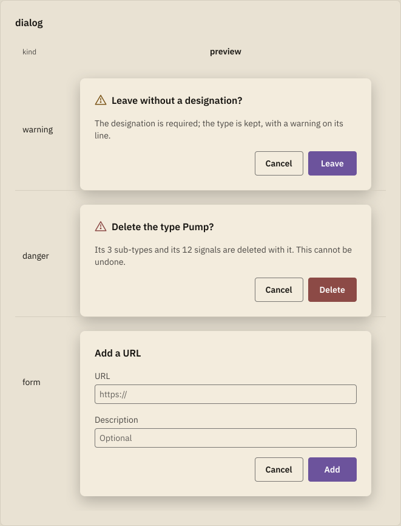

# dialog

> [Home](../../README.md) › [Design system](../README.md) › [Organisms](README.md) › dialog

A window over the screen that asks to confirm, mostly a delete, or asks for a value: a heading, a text or [fields](../07-molecules/field.md), and two [buttons](../06-atoms/button.md).

## Figma

| Node | Id |
| --- | --- |
| Component set | [`640:706`](https://www.figma.com/design/2hW8t5CgVru1VFbQZ1yETL/?node-id=640-706) |

## Variants and states

## Inputs

| Input | Type | Default | Figma |
| --- | --- | --- | --- |
| `kind` | `warning`, `danger`, `form` | `warning` | variant `kind` |
| `heading` | text | — | its heading |
| `text` | text | — | its text (`warning`, `danger`) |
| `fields` | list of fields | — | its fields (`form`) |
| `action` | text | — | the label of the primary or danger button |

## Outputs

| Output | When | Value |
| --- | --- | --- |
| `confirm` | The action button, or Enter. | the values of the fields (`form`) |
| `cancel` | Cancel, Escape, or a click outside. | — |

## Behaviour

- The screen behind is dimmed; the focus stays inside the dialog while it is open.
- `danger`: the action is a `danger` button.

## Made of

| Component | Role |
| --- | --- |
| [button](../06-atoms/button.md) | Cancel and the action. |
| [field](../07-molecules/field.md) | The fields of kind form. |
