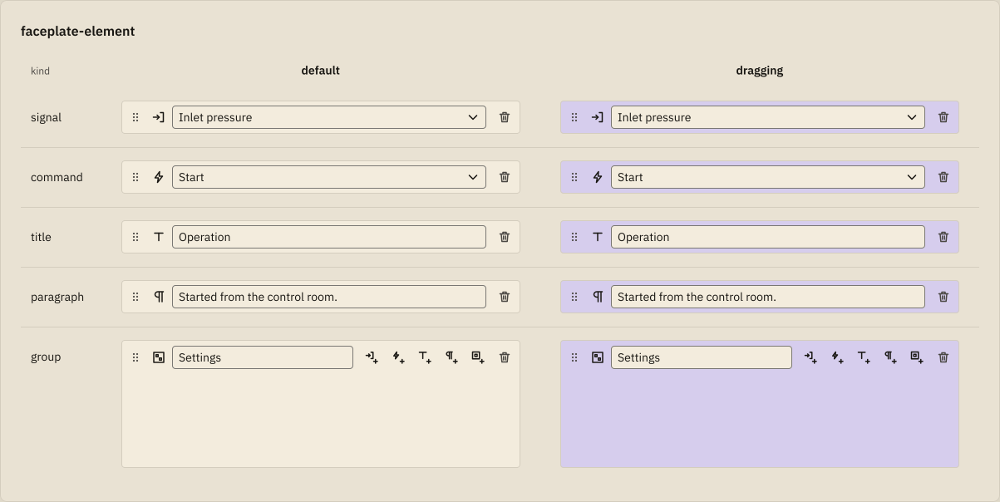

# faceplate-element

> [Home](../../README.md) › [Design system](../README.md) › [Organisms](README.md) › faceplate-element

One element of the faceplate builder of a type: a [drag-handle](../06-atoms/drag-handle.md), the icon of its kind, the fields of its kind, and delete. A group holds its own elements.

## Figma

| Node | Id |
| --- | --- |
| Component set | [`642:1828`](https://www.figma.com/design/2hW8t5CgVru1VFbQZ1yETL/?node-id=642-1828) |

## Variants and states

## Inputs

| Input | Type | Default | Figma |
| --- | --- | --- | --- |
| `kind` | `signal`, `command`, `title`, `paragraph`, `group` | `signal` | variant `kind` |
| `fields` | the fields of its kind | — | slot `fields` |
| `addButtons` | the five add buttons | — | slot `actions`, group only |
| `elements` | its own elements | — | slot `elements`, group only, indented by `spacing-07` |

## Outputs

| Output | When | Value |
| --- | --- | --- |
| `change` | A field changes. | the field and the value |
| `add` | An add button of a group. | the kind added |
| `move` | The element is dropped at a new place, by its handle. | the new place |
| `delete` | A click on delete. | — |

## Behaviour

- `dragging` (`layer-selected`, violet): only while its handle is held, as a line of a table; a click on the element itself does nothing.
- A signal is on one line (2026-11-24, since the builder takes the whole main column): the signal, its display name, read or write (read or override, a horizontal [radio-group](../07-molecules/radio-group.md)), then in write or override the kind of input and, for a number, the minimum and the maximum, of the same width. In the slot `fields`, a frame `lines` lays its two groups side by side.
- An element that comes from a parent keeps its handle and its fill (`layer-02`), as any other element, since a sub-type may move it; only its delete is hidden and its fields are `state=read-only`, radios included (2026-11-24): read only, never disabled, so that it still reads as a line that moves.
- In a group, the delete follows the add buttons `spacing-02` apart, as one row of buttons.
- The kind `paragraph` is shown "Description" on the screens and in its icon `description` (MD-14.8).

## Made of

| Component | Role |
| --- | --- |
| [drag-handle](../06-atoms/drag-handle.md) | Moves the element. |
| [Icons](../05-icons/README.md) | The icon of its kind; the add icons of a group. |
| [select-trigger](../06-atoms/select-trigger.md) | The signal, the kind of input. |
| [text-input](../06-atoms/text-input.md) | Labels, titles. |
| [text-area](../06-atoms/text-area.md) | The text of a description. |
| [number-input](../06-atoms/number-input.md) | Minimum and maximum. |
| [radio-group](../07-molecules/radio-group.md) | Read or write, read or override. |
| [icon-button](../06-atoms/icon-button.md) | The add buttons of a group, delete. |
