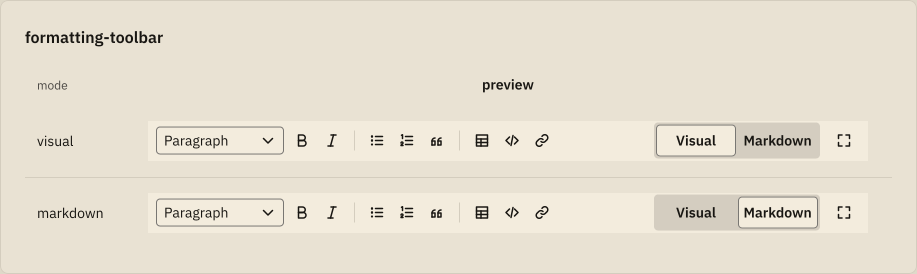

# formatting-toolbar

> [Home](../../README.md) › [Design system](../README.md) › [Organisms](README.md) › formatting-toolbar

The tool bar of the documentation editor: the heading [select-trigger](../06-atoms/select-trigger.md), the [toolbar-group](../07-molecules/toolbar-group.md) of formatting, the [segmented-control](../07-molecules/segmented-control.md) Visual or Markdown, and the full page [icon-button](../06-atoms/icon-button.md). The same groups in both modes.

## Figma

| Node | Id |
| --- | --- |
| Component set | [`642:1302`](https://www.figma.com/design/2hW8t5CgVru1VFbQZ1yETL/?node-id=642-1302) |

## Variants and states

## Inputs

| Input | Type | Default | Figma |
| --- | --- | --- | --- |
| `mode` | `visual`, `markdown` | `visual` | variant `mode` |
| `heading` | Paragraph, Heading 1 to 6 | Paragraph | the value of its select-trigger |
| `bold`, `italic` | boolean | `false` | its [toggle-button](../06-atoms/toggle-button.md): the state of the selected text |
| `fullPage` | boolean | `false` | the icon `full-page` or `exit-full-page` |

## Outputs

| Output | When | Value |
| --- | --- | --- |
| `format` | A formatting button: bold, italic, lists, code, quote. | the format |
| `headingChange` | A level chosen in its list. | the level |
| `insertTable` | A size chosen in the [table-size-picker](../07-molecules/table-size-picker.md). | columns and rows |
| `modeChange` | Visual or Markdown. | the mode |
| `fullPageChange` | The full page button. | `true` or `false` |

## Behaviour

- Bold and italic are `spacing-02` after the heading select; the other groups are `spacing-03` apart, with a divider.
- The heading list opens right under its select; the table button opens its grid right under it and stays `selected` while it is open.

## Made of

| Component | Role |
| --- | --- |
| [select-trigger](../06-atoms/select-trigger.md) | Paragraph, Heading 1 to 6. |
| [menu](../07-molecules/menu.md) | The list of the heading levels. |
| [toolbar-group](../07-molecules/toolbar-group.md) | Each group of formatting buttons. |
| [toggle-button](../06-atoms/toggle-button.md) | Bold, italic. |
| [table-size-picker](../07-molecules/table-size-picker.md) | The grid of the table button. |
| [divider](../06-atoms/divider.md) | Between the groups. |
| [segmented-control](../07-molecules/segmented-control.md) | Visual, Markdown. |
| [icon-button](../06-atoms/icon-button.md) | Full page. |
