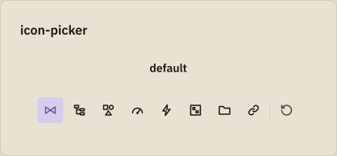

# icon-picker

> [Home](../../README.md) › [Design system](../README.md) › [Organisms](README.md) › icon-picker

The icons a type can take: [icon-button](../06-atoms/icon-button.md) for each icon of the icon set, and a reset to the icon of the parent.

## Figma

| Node | Id |
| --- | --- |
| Component | [`641:1489`](https://www.figma.com/design/2hW8t5CgVru1VFbQZ1yETL/?node-id=641-1489) |

## Variants and states

## Inputs

| Input | Type | Default | Figma |
| --- | --- | --- | --- |
| `icons` | the icons of the set | — | its icon buttons |
| `value` | the chosen icon, or the parent's | the parent's | the icon button in `state=selected` |

## Outputs

| Output | When | Value |
| --- | --- | --- |
| `valueChange` | An icon is chosen. | the icon |
| `reset` | The reset button: follow the parent again. | — |

## Behaviour

- The icons of the types are files of Metadata ([Icon](../../metadata/entities/03-icon.md)), not the icons of the interface.
- The reset is set apart from the icons, after a vertical divider, as a `quiet` icon button: it never reads as one more icon.

## Made of

| Component | Role |
| --- | --- |
| [icon-button](../06-atoms/icon-button.md) | Each icon (`kind=ghost`), and reset (`kind=quiet`). |
| [divider](../06-atoms/divider.md) | Vertical, 20 px, between the icons and the reset. |
