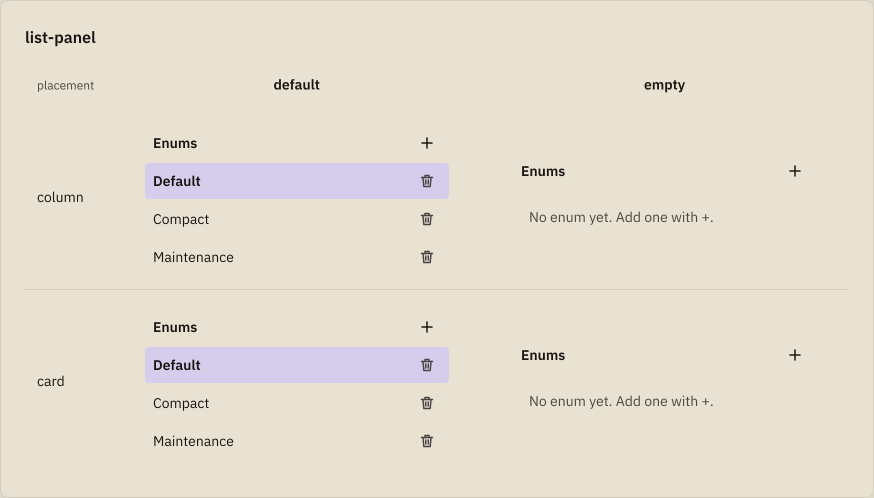

# list-panel

> [Home](../../README.md) › [Design system](../README.md) › [Organisms](README.md) › list-panel

A titled list with its +: a [list-title](../07-molecules/list-title.md) and [list-row](../07-molecules/list-row.md) lines.

## Figma

| Node | Id |
| --- | --- |
| Component set | [`640:651`](https://www.figma.com/design/2hW8t5CgVru1VFbQZ1yETL/?node-id=640-651) |

## Variants and states

## Inputs

| Input | Type | Default | Figma |
| --- | --- | --- | --- |
| `placement` | `column` or `card` | `column` | `placement=column`: square corners, for a list that fills a column; `placement=card`: corners `radius-md`, for a list laid as a card in the main zone, beside a [data-table](data-table.md) |
| `title` | text | — | its list-title |
| `items` | list of rows | — | slot `rows`, filled with list-row |
| `selected` | the selected item | none | the list-row in `state=selected` |
| `empty` | — | — | `state=empty`: a message |

## Outputs

| Output | When | Value |
| --- | --- | --- |
| `select` | A line is chosen. | the item |
| `add` | The + of the title. | — |
| `delete` | The delete of a line. | the item |

## Made of

| Component | Role |
| --- | --- |
| [list-title](../07-molecules/list-title.md) | Its title and its +. |
| [list-row](../07-molecules/list-row.md) | Each item, in the slot rows. |

## Behaviour

- `placement=card`: padding `spacing-02` (4) at the top, `spacing-03` (8) at the bottom and on the sides, so that a selected last line keeps the margin of the sides. Its list-title has `spacing-01` (2) on its right, so that the + lines up with the text of the title, 16 from the edge (Product Owner, 2026-11-23).
