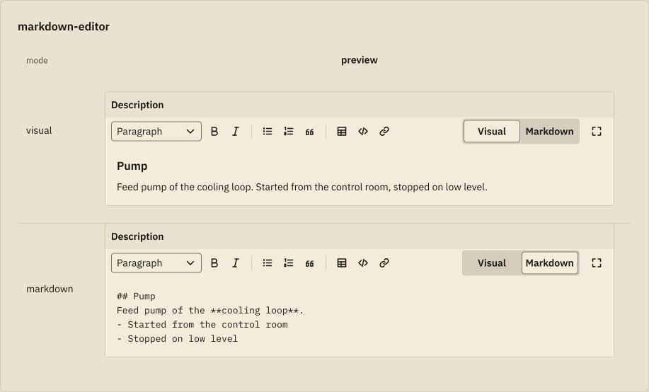

# markdown-editor

> [Home](../../README.md) › [Design system](../README.md) › [Organisms](README.md) › markdown-editor

The documentation editor of a type: a [list-title](../07-molecules/list-title.md) "Description" with no button, the [formatting-toolbar](formatting-toolbar.md), and the editing area.

## Figma

| Node | Id |
| --- | --- |
| Component set | [`642:1487`](https://www.figma.com/design/2hW8t5CgVru1VFbQZ1yETL/?node-id=642-1487) |

## Variants and states

## Inputs

| Input | Type | Default | Figma |
| --- | --- | --- | --- |
| `value` | Markdown text | empty | the text of its editing area |
| `mode` | `visual`, `markdown` | `visual` | variant `mode`: the text formatted, or its Markdown source |
| `fullPage` | boolean | `false` | the full page state: the editing area fills down to the bottom |
| `inherited` | Markdown text of the parents | empty | boolean `inherited` (2026-11-24): a block `inherited` at the top of the editing area, in `text-secondary`, a `border-subtle` line under it, showing the description of the parents, read only |
| — | — | — | boolean `sample`, Figma only: shows the [description-sample](description-sample.md) in the editing area of `mode=visual`; a screen that turns it on hides the default heading and text |

## Outputs

| Output | When | Value |
| --- | --- | --- |
| `valueChange` | The text changes. | the Markdown text |
| `modeChange`, `fullPageChange` | From its tool bar. | the mode, the full page |

## Behaviour

- Its corners are `radius-md` (8), as every card of a screen: the tables, the panels (2026-11-24; `radius-sm` until then).
- No read-only mode.
- In a sub-type, the description of each parent, from the root down, comes first, read only; only the type's own text, under it, can be edited, so that each level adds its chapter (MD-03.12).
- In `visual`, the text is drawn with the styles of a description: Heading 1 to 6 all larger than the paragraph ([Foundations](../02-foundations.md#styles-of-a-description)); a table is a [content-table](../07-molecules/content-table.md), with its + on hover (MD-03.13).
- In full page, the description takes the whole editing part; the links are hidden; the tree and the menus stay (MD-03.4c).

## Made of

| Component | Role |
| --- | --- |
| [list-title](../07-molecules/list-title.md) | Description, no button. |
| [formatting-toolbar](formatting-toolbar.md) | Its tool bar. |
| [description-sample](description-sample.md) | The sample content, hidden unless `sample` is on. |
