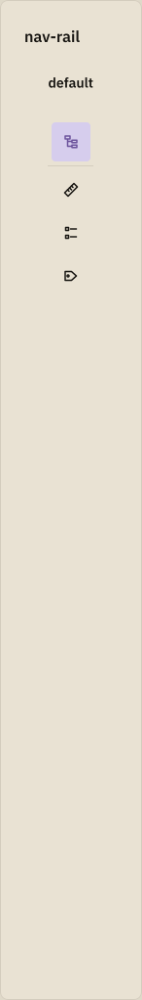

# nav-rail

> [Home](../../README.md) › [Design system](../README.md) › [Organisms](README.md) › nav-rail

The vertical bar of icons that switches the pages of a part: [nav-rail-item](../07-molecules/nav-rail-item.md) `rail` and a [divider](../06-atoms/divider.md); in the symbol mode, also the Symbol Libs as [nav-rail-library](../07-molecules/nav-rail-library.md).

## Figma

| Node | Id |
| --- | --- |
| Component set | [`757:2916`](https://www.figma.com/design/2hW8t5CgVru1VFbQZ1yETL/?node-id=757-2916) |
| Variant `part=metadata` | [`640:201`](https://www.figma.com/design/2hW8t5CgVru1VFbQZ1yETL/?node-id=640-201) |
| Variant `part=symbols` | [`757:2700`](https://www.figma.com/design/2hW8t5CgVru1VFbQZ1yETL/?node-id=757-2700) |

## Variants and states

The table shows `part=metadata` only; `part=symbols` is not exported yet.

## Inputs

| Input | Type | Default | Figma |
| --- | --- | --- | --- |
| `part` | `metadata`, `symbols` | `metadata` | variant `part` |
| `pages` | list: icon, name | the pages of the part | its items |
| `page` | the selected page | Types | the item in `state=selected` |
| `libraries` | list: initials, name | — | `part=symbols`: the items `library-01` to `library-15`, shown or hidden |
| `library` | the selected Symbol Lib | — | the nav-rail-library in `state=selected` |
| `libraryPart` | the part of the list shown, and how many | 1 of 1 | the items `previous-part` and `next-part`, shown or hidden |

## Outputs

| Output | When | Value |
| --- | --- | --- |
| `pageChange` | A click on a page not selected. | the page |
| `libraryChange` | `part=symbols`: a click on a library not selected. | the library |
| `librariesOpen` | `part=symbols`: a click on Libraries. | — |
| `libraryPartChange` | `part=symbols`: a click on an arrow. | the part |

## Behaviour

- In Metadata, the divider sits after Types: the type, then what the types use (Units, Enums, Designations).
- In the symbol mode ([SY-00](../../screens/symbols.md#sy-00--navigation-bar-of-the-symbol-mode)): Libraries at the top; the list of the Symbol Libs takes the room down to the divider; the divider and the pages Enums, Pipes, Symbols sit at the bottom, shown only once a library is selected.
- The list of the Symbol Libs never scrolls: at 1600 × 900 it holds 15 items. When the libraries do not fit, an arrow takes the last place, `next-part` (chevron down, "Part 1 of 2" on hover); a later part starts with `previous-part` (chevron up). The arrows are a proposal of the assistant.
- The up and down arrows of the keyboard move the focus from item to item.

## Made of

| Component | Role |
| --- | --- |
| [nav-rail-item](../07-molecules/nav-rail-item.md) | Each page, Libraries and the arrows, placement rail. |
| [nav-rail-library](../07-molecules/nav-rail-library.md) | Each Symbol Lib, `part=symbols`. |
| [divider](../06-atoms/divider.md) | After Types; in the symbol mode, before the pages. |
