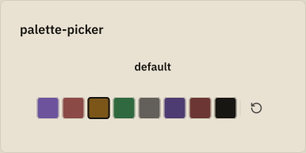

# palette-picker

> [Home](../../README.md) › [Design system](../README.md) › [Organisms](README.md) › palette-picker

The colours a type can take: the [colour-swatch](../06-atoms/colour-swatch.md) of the palette, and a reset to the colour of the parent.

## Figma

| Node | Id |
| --- | --- |
| Component | [`641:1471`](https://www.figma.com/design/2hW8t5CgVru1VFbQZ1yETL/?node-id=641-1471) |

## Variants and states

## Inputs

| Input | Type | Default | Figma |
| --- | --- | --- | --- |
| `palette` | list of colours | sample colours | its swatches, until the palette of the project is known |
| `value` | the chosen colour, or the parent's | the parent's | the swatch in `state=selected` |

## Outputs

| Output | When | Value |
| --- | --- | --- |
| `valueChange` | A swatch is chosen. | the colour |
| `reset` | The reset button: follow the parent again. | — |

## Behaviour

- The reset is set apart from the colours, after a vertical divider, as a `quiet` icon button: it never reads as one more choice (the same here).

## Made of

| Component | Role |
| --- | --- |
| [colour-swatch](../06-atoms/colour-swatch.md) | Each colour. |
| [divider](../06-atoms/divider.md) | Vertical, 20 px, between the colours and the reset. |
| [icon-button](../06-atoms/icon-button.md) | Reset, `kind=quiet`. |
