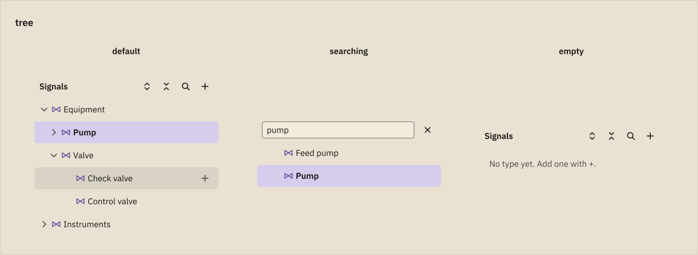

# tree

> [Home](../../README.md) › [Design system](../README.md) › [Organisms](README.md) › tree

The type tree: its [list-title](../07-molecules/list-title.md) `actions=tree` and its [tree-row](../07-molecules/tree-row.md) lines.

## Figma

| Node | Id |
| --- | --- |
| Component set | [`640:573`](https://www.figma.com/design/2hW8t5CgVru1VFbQZ1yETL/?node-id=640-573) |

## Variants and states

## Inputs

| Input | Type | Default | Figma |
| --- | --- | --- | --- |
| `types` | the tree of the types: name, icon, colour, children | — | slot `rows`, filled with tree-row |
| `selected` | the selected type | none | the tree-row in `state=selected` |
| `searching` | boolean | `false` | `state=searching` |
| `empty` | — | — | `state=empty`: no type yet, a message |

## Outputs

| Output | When | Value |
| --- | --- | --- |
| `select` | A line is chosen. | the type |
| `addRoot` | The + of the title. | — |
| `addChild` | The + of a line. | the parent type |
| `queryChange` | The search field changes. | the text |

## Behaviour

- `spacing-03` on each side and `spacing-01` between lines; a line in hover or selected never touches the edges.
- Open all and close all act on every branch.

## Made of

| Component | Role |
| --- | --- |
| [list-title](../07-molecules/list-title.md) | Type tree, actions tree. |
| [tree-row](../07-molecules/tree-row.md) | Each type, in the slot rows. |
