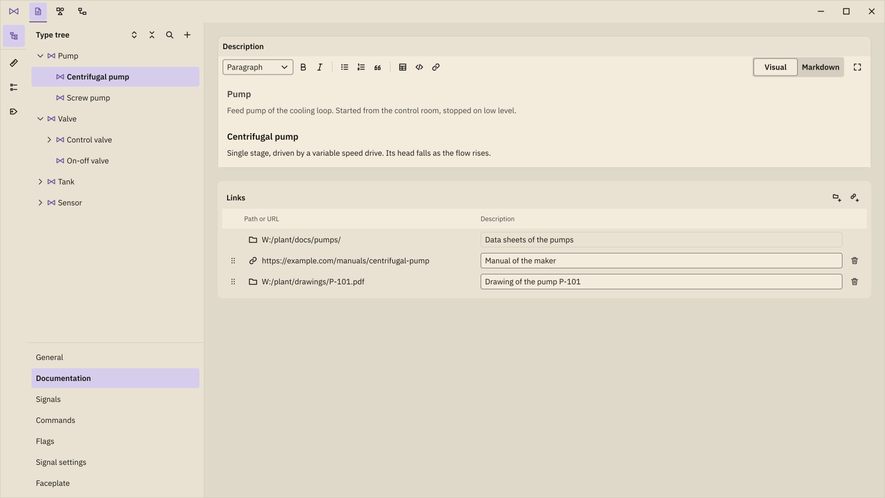
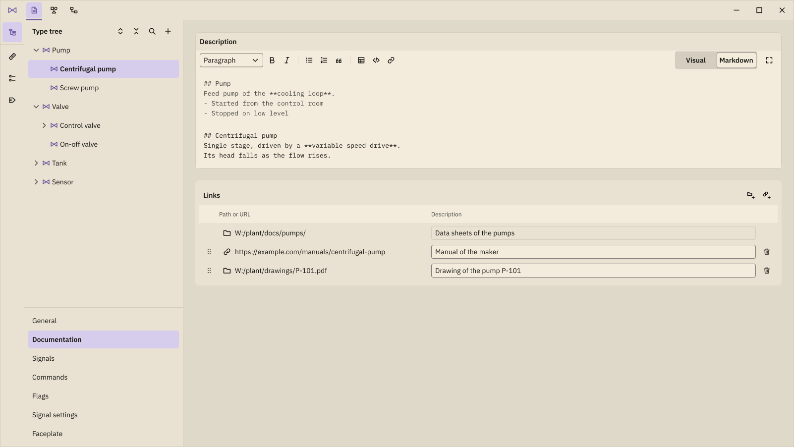
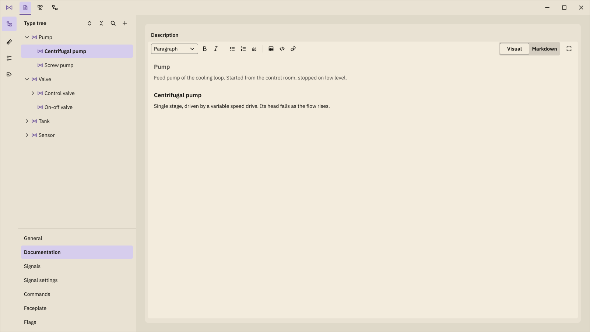
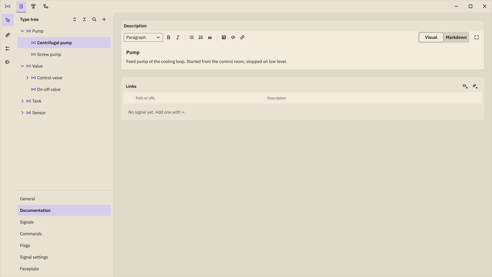
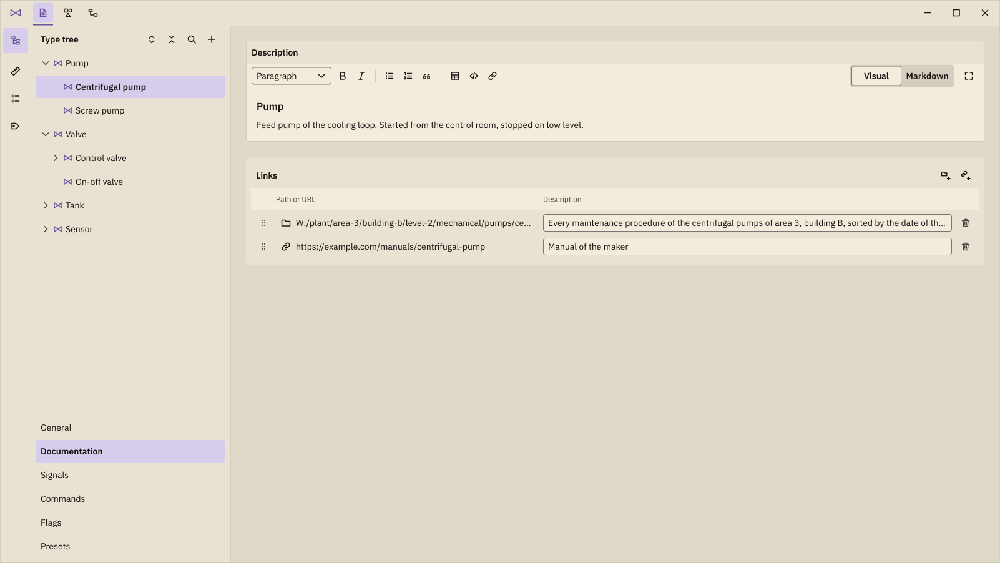
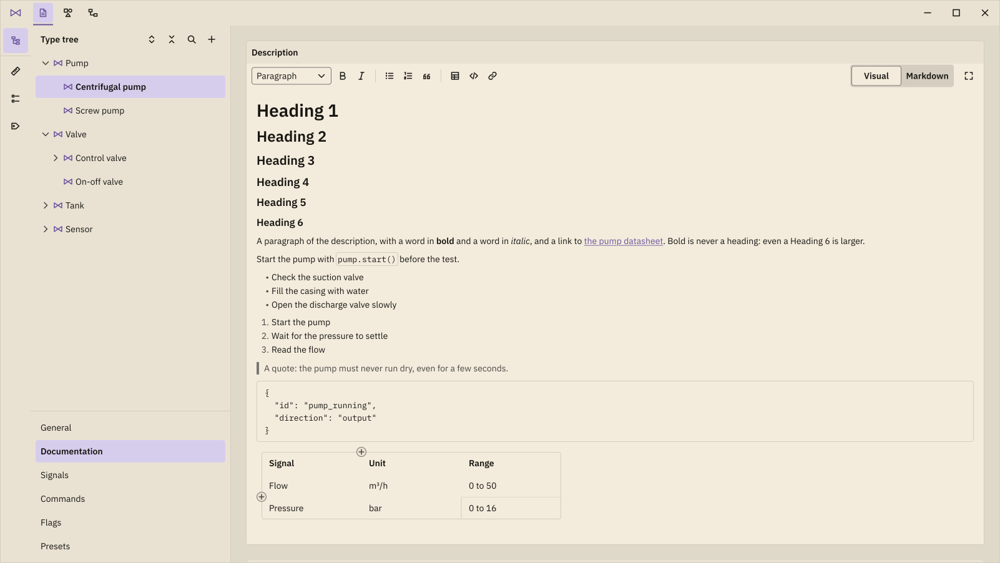
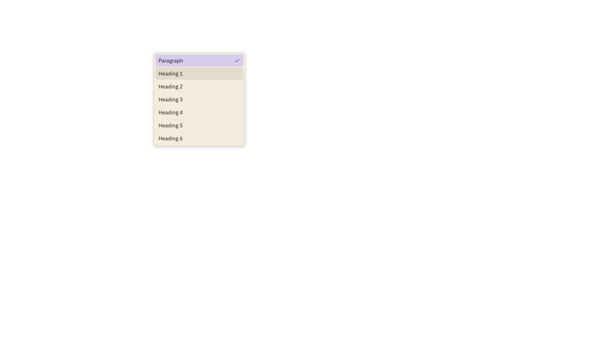
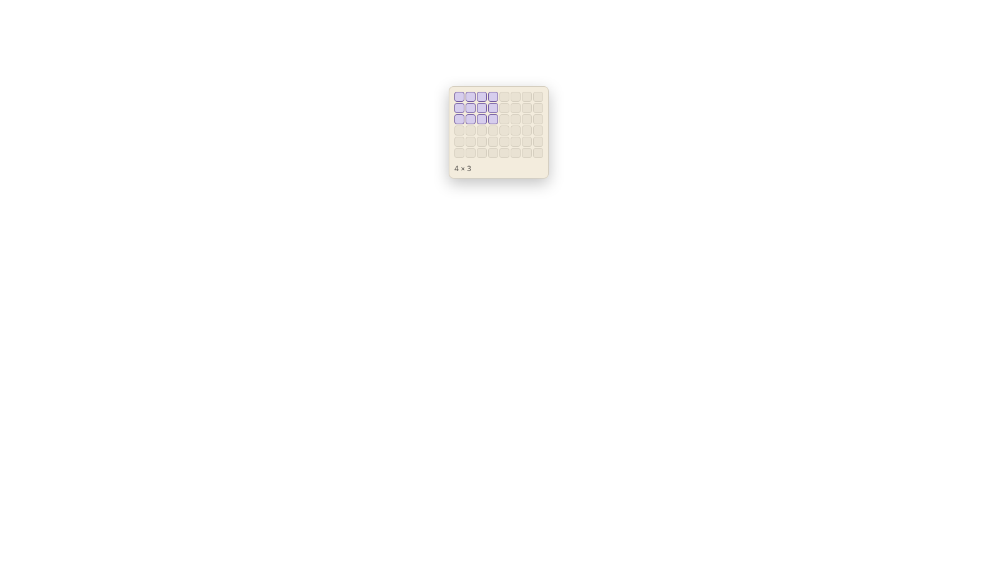
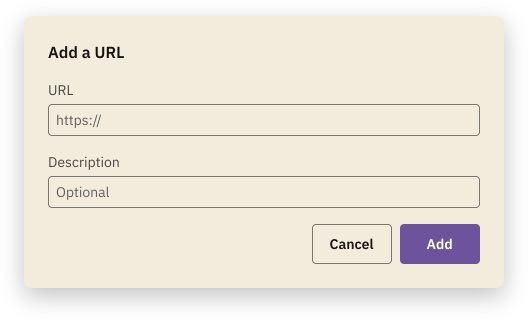
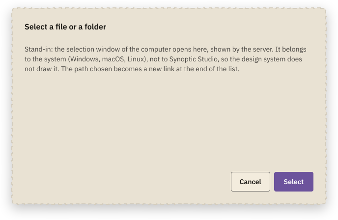

# MD-03 Documentation

> [Home](../../../README.md) › [Design system](../../README.md) › [Screens](../README.md) › [Screens of Metadata](README.md) › Documentation

The documentation of a type: its description in the [markdown-editor](../../08-organisms/markdown-editor.md) and its links. Controls: [MD-03](../../../screens/metadata.md#md-03--documentation).

The description is a card like the table of the links (2026-11-24): `layer-01`, `radius-md`, `spacing-04` above and below, `spacing-03` on the sides; inside, the tool bar and the text zone in `layer-02`, so that the text zone shows.

Drawn for `centrifugal_pump`, a sub-type of `pump` (2026-11-24). In visual, markdown and full page, the editor shows the description of `pump` first, read only, in `text-secondary`, a line under it (property `inherited` of the markdown-editor); the own text of `centrifugal_pump` follows, the only one that can be edited. The first link comes from `pump`: a [data-table-row](../../07-molecules/data-table-row.md) `kind=inherited`, with no handle nor delete, its description `state=read-only`. The other states (no link, long text, headings and table) show the type's own part only.

## Figma

| Frame | Id |
| --- | --- |
| Section · the screens | [`667:9805`](https://www.figma.com/design/2hW8t5CgVru1VFbQZ1yETL/?node-id=667-9805) |
| Section · the lists of the tool bar | [`684:14751`](https://www.figma.com/design/2hW8t5CgVru1VFbQZ1yETL/?node-id=684-14751) |
| Section · the links | [`679:15292`](https://www.figma.com/design/2hW8t5CgVru1VFbQZ1yETL/?node-id=679-15292) |
| MD-03 · Documentation · visual | [`667:10608`](https://www.figma.com/design/2hW8t5CgVru1VFbQZ1yETL/?node-id=667-10608) |
| MD-03 · Documentation · markdown | [`667:11451`](https://www.figma.com/design/2hW8t5CgVru1VFbQZ1yETL/?node-id=667-11451) |
| MD-03 · Documentation · full page | [`667:12243`](https://www.figma.com/design/2hW8t5CgVru1VFbQZ1yETL/?node-id=667-12243) |
| MD-03 · Documentation · no link | [`667:12582`](https://www.figma.com/design/2hW8t5CgVru1VFbQZ1yETL/?node-id=667-12582) |
| MD-03 · Documentation · long text | [`667:12922`](https://www.figma.com/design/2hW8t5CgVru1VFbQZ1yETL/?node-id=667-12922) |
| MD-03 · Documentation · headings and table | [`732:14866`](https://www.figma.com/design/2hW8t5CgVru1VFbQZ1yETL/?node-id=732-14866) |
| MD-03 · Heading level | [`684:14752`](https://www.figma.com/design/2hW8t5CgVru1VFbQZ1yETL/?node-id=684-14752) |
| MD-03 · Insert a table | [`684:14867`](https://www.figma.com/design/2hW8t5CgVru1VFbQZ1yETL/?node-id=684-14867) |
| MD-03 · Add a URL | [`679:15293`](https://www.figma.com/design/2hW8t5CgVru1VFbQZ1yETL/?node-id=679-15293) |
| MD-03 · Add a path · window of the computer | [`679:15322`](https://www.figma.com/design/2hW8t5CgVru1VFbQZ1yETL/?node-id=679-15322) |

## Screens

### MD-03 · Documentation · visual

### MD-03 · Documentation · markdown

### MD-03 · Documentation · full page

### MD-03 · Documentation · no link

### MD-03 · Documentation · long text

### MD-03 · Documentation · headings and table

Every heading level, a paragraph with bold, italic and a link, inline code, both lists, a quote, a code block, and a table under the mouse, with its + to insert or add a line or a column ([MD-03.13](../../../screens/metadata.md#md-03--documentation)): the [description-sample](../../08-organisms/description-sample.md) shown by the property `sample` of the markdown-editor.

### MD-03 · Heading level

The list of the heading select, right under it. A transparent frame of the size of the screen, closed by a click anywhere.

### MD-03 · Insert a table

The grid of the table button, right under it.

### MD-03 · Add a URL

The dialog the URL icon of the links opens.

### MD-03 · Add a path · window of the computer

A stand-in for the window of the system, opened by the path icon.

