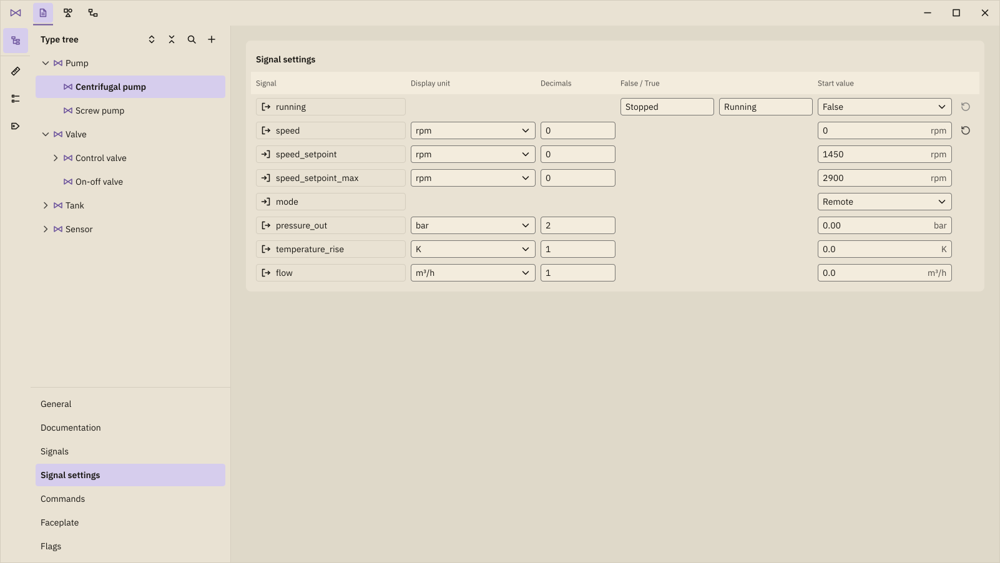
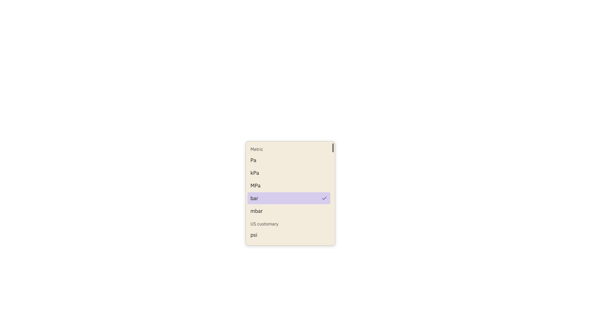

# MD-07 Signal settings

> [Home](../../../README.md) › [Design system](../../README.md) › [Screens](../README.md) › [Screens of Metadata](README.md) › Signal settings

The values of every signal of a type, own and inherited, in one [data-table](../../08-organisms/data-table.md) that takes the whole main column, under its title "Signal settings" with no button, as the other tables: no list on its left, no name, no switch (2026-11-24, no more presets). Its columns are 240, 200, 120, 150 and 150 wide, and Start value takes the rest, so that no column is much wider than the others. Drawn for `centrifugal_pump`, a sub-type of `pump`: its first two lines, `running` and `speed`, are inherited, and their settings can be changed like the others. A last column with no header holds, on each inherited line, the [icon-button](../../06-atoms/icon-button.md) `reset` (MD-07.28): enabled on `speed`, whose settings the sub-type changed, disabled on `running`, which follows `pump`; an empty place of the same width on the own lines. Controls: [MD-07](../../../screens/metadata.md#md-07--signal-settings).

## Figma

| Frame | Id |
| --- | --- |
| Section | [`668:9609`](https://www.figma.com/design/2hW8t5CgVru1VFbQZ1yETL/?node-id=668-9609) |
| MD-07 · Signal settings | [`668:9610`](https://www.figma.com/design/2hW8t5CgVru1VFbQZ1yETL/?node-id=668-9610) |
| MD-07 · Display unit | [`706:13686`](https://www.figma.com/design/2hW8t5CgVru1VFbQZ1yETL/?node-id=706-13686) |

## Screens

### MD-07 · Signal settings

### MD-07 · Display unit

The grouped list the display unit `bar` of `pressure_out` opens: a transparent frame of the size of the screen, the list right under its select. Two groups: Metric, then US customary, which holds psi, inHg, inH2O and ftH2O.

