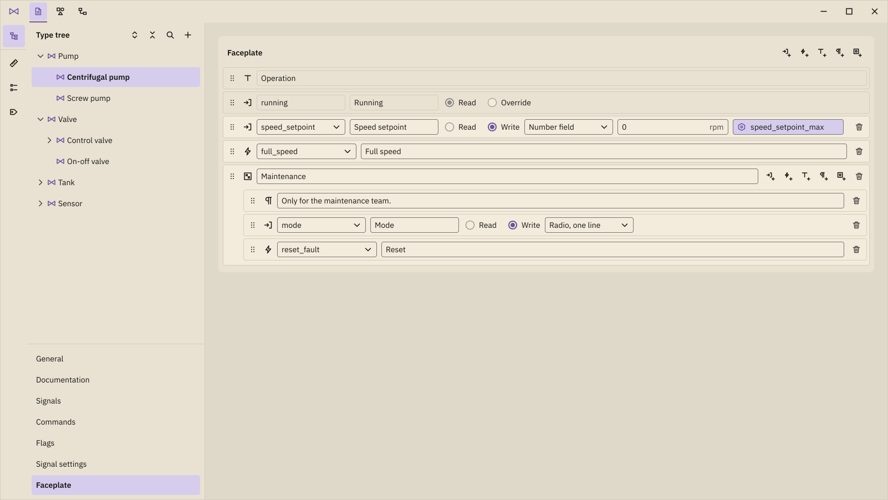

# MD-14 Faceplate

> [Home](../../../README.md) › [Design system](../../README.md) › [Screens](../README.md) › [Screens of Metadata](README.md) › Faceplate

The faceplate builder of a type: the title "Faceplate" with its five add icons, then the [faceplate-elements](../../08-organisms/faceplate-element.md), in the whole main column; no list on its left, no name, no switch (2026-11-24, no more presets). Controls: [MD-14](../../../screens/metadata.md#md-14--faceplate).

Drawn for `centrifugal_pump`, a sub-type of `pump`: its first two elements, the title Operation and the signal `running`, come from `pump`. They keep their handle, since a sub-type may move them, but have no delete button and no fill of their own (`layer-transparent`), and their fields are `state=read-only` (a radio `state=disabled`): the whole line reads as read only. Every element is one line high, 40: a signal sits on one line, its input after read or write; its selects and text fields are 160 wide, its minimum and maximum 200, so that no field is much wider than the others. The title and the elements sit in a card, as the tables (2026-11-24): `layer-01`, `radius-md`, `spacing-04` above and below, `spacing-03` on the sides. The title sits `spacing-03` (8) above its first element.

## Figma

| Frame | Id |
| --- | --- |
| Section | [`858:15982`](https://www.figma.com/design/2hW8t5CgVru1VFbQZ1yETL/?node-id=858-15982) |
| MD-14 · Faceplate | [`668:11695`](https://www.figma.com/design/2hW8t5CgVru1VFbQZ1yETL/?node-id=668-11695) |

## Screens

### MD-14 · Faceplate

