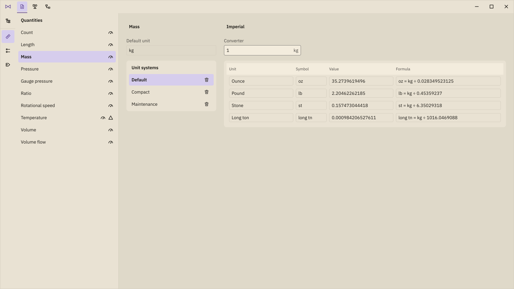
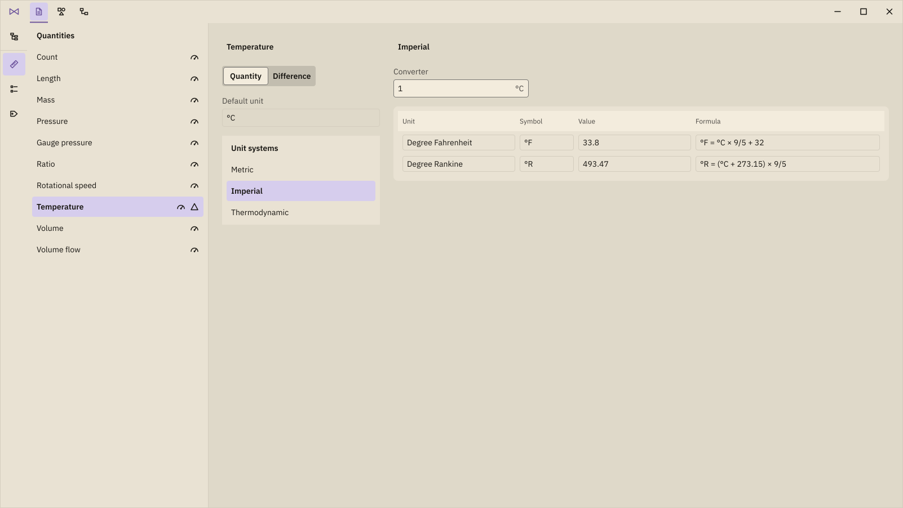
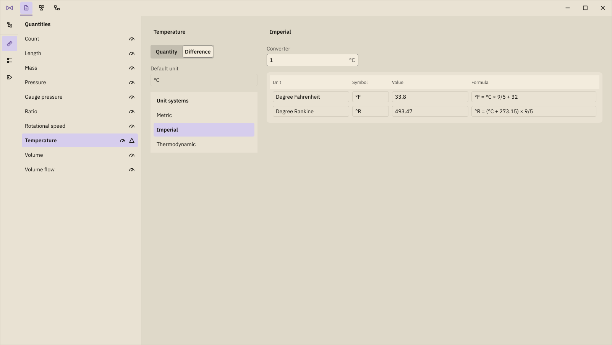

# MD-08 Units

> [Home](../../../README.md) › [Design system](../../README.md) › [Screens](../README.md) › [Screens of Metadata](README.md) › Units

The quantities and their units in a unit system. Controls: [MD-08](../../../screens/metadata.md#md-08--units).

## Figma

| Frame | Id |
| --- | --- |
| Section | [`669:11672`](https://www.figma.com/design/2hW8t5CgVru1VFbQZ1yETL/?node-id=669-11672) |
| MD-08 · Units | [`669:11673`](https://www.figma.com/design/2hW8t5CgVru1VFbQZ1yETL/?node-id=669-11673) |
| MD-08 · Units · temperature | [`669:13261`](https://www.figma.com/design/2hW8t5CgVru1VFbQZ1yETL/?node-id=669-13261) |
| MD-08 · Units · temperature · difference | [`726:12505`](https://www.figma.com/design/2hW8t5CgVru1VFbQZ1yETL/?node-id=726-12505) |

## Screens

### MD-08 · Units

Mass, in Imperial.

### MD-08 · Units · temperature

Temperature, in Imperial, with its switch on Quantity.

### MD-08 · Units · temperature · difference

The same screen, the switch on Difference; the two screens lead from one to the other (2026-11-22).

