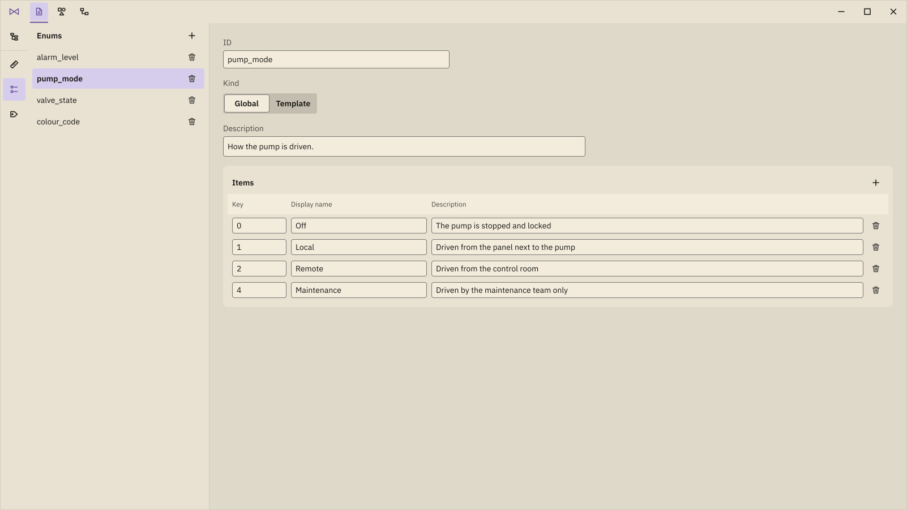
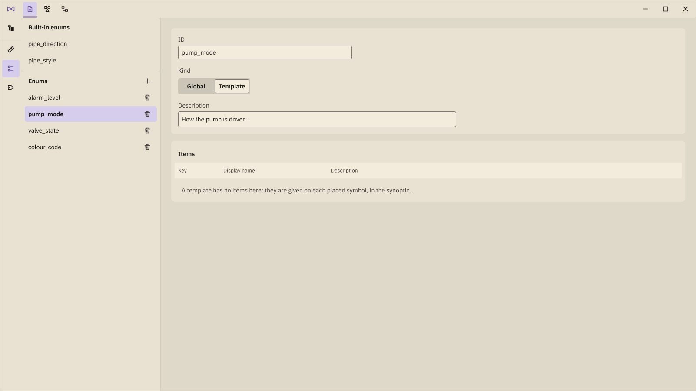
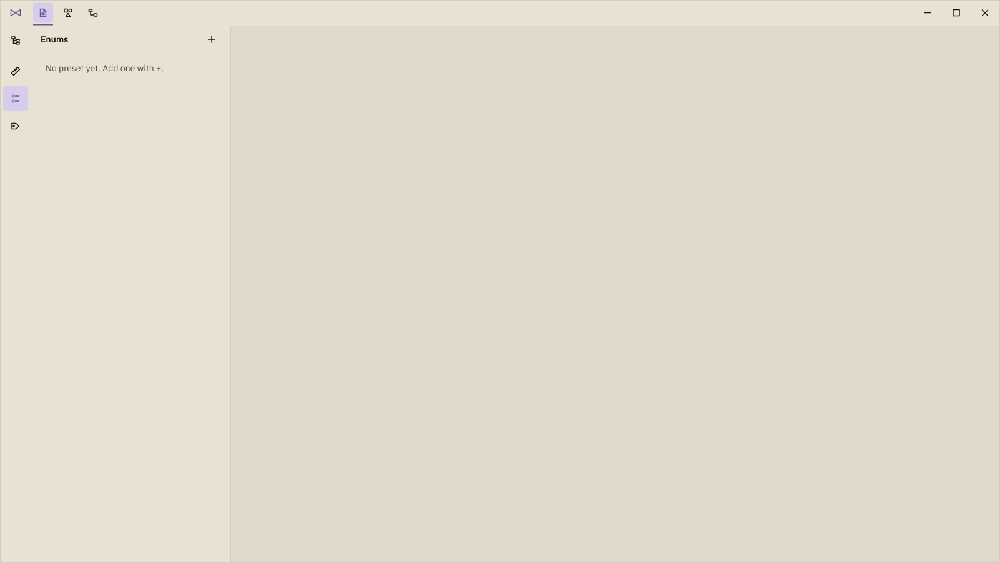
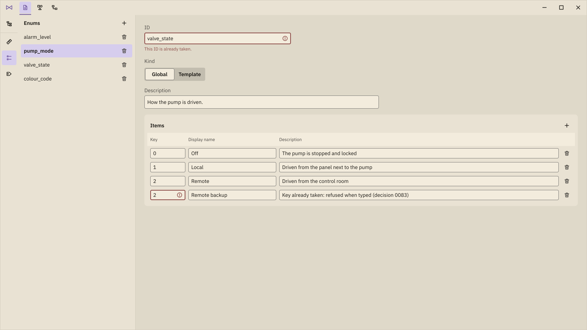
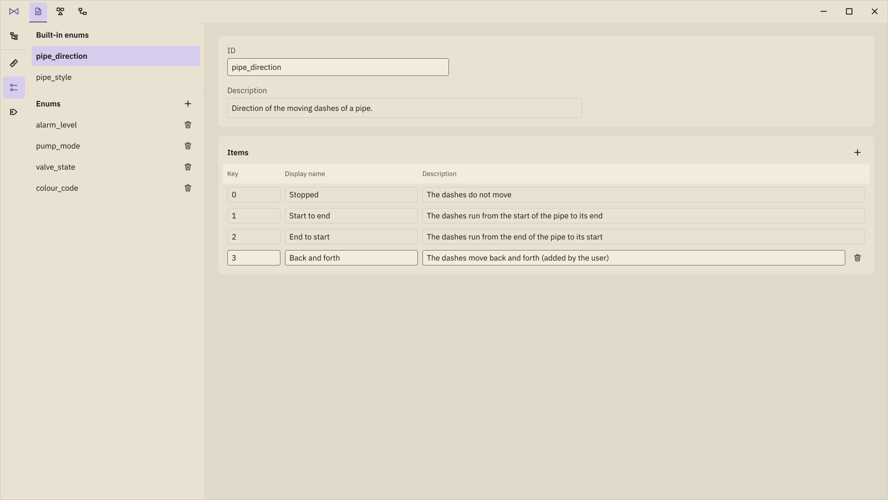
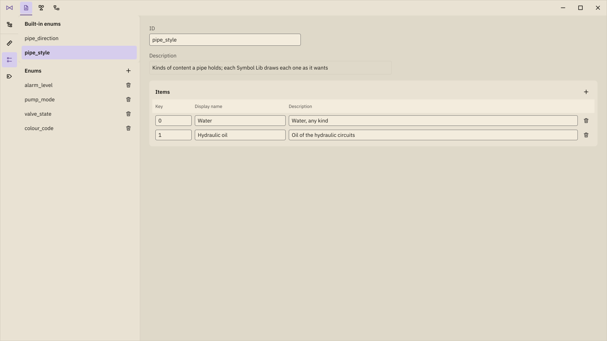

# MD-09 Enums

> [Home](../../../README.md) › [Design system](../../README.md) › [Screens](../README.md) › [Screens of Metadata](README.md) › Enums

The enums, global or template, and their items. Controls: [MD-09](../../../screens/metadata.md#md-09--enums).

The ID, the kind and the description of the enum sit in a card above the table of its items, as the tables (2026-11-24): `layer-01`, `radius-md`, `spacing-05` (16) inside. The list of built-in enums shows `pipe_direction` and `pipe_style` on every screen; a click on one opens its screen, as a click on `pump_mode`.

## Figma

| Frame | Id |
| --- | --- |
| Section | [`669:14179`](https://www.figma.com/design/2hW8t5CgVru1VFbQZ1yETL/?node-id=669-14179) |
| MD-09 · Enums | [`669:14180`](https://www.figma.com/design/2hW8t5CgVru1VFbQZ1yETL/?node-id=669-14180) |
| MD-09 · Enums · template | [`669:15030`](https://www.figma.com/design/2hW8t5CgVru1VFbQZ1yETL/?node-id=669-15030) |
| MD-09 · Enums · empty | [`669:15241`](https://www.figma.com/design/2hW8t5CgVru1VFbQZ1yETL/?node-id=669-15241) |
| MD-09 · Enums · error | [`669:15338`](https://www.figma.com/design/2hW8t5CgVru1VFbQZ1yETL/?node-id=669-15338) |
| MD-09 · Enums · built-in | [`804:14316`](https://www.figma.com/design/2hW8t5CgVru1VFbQZ1yETL/?node-id=804-14316) |
| MD-09 · Enums · built-in pipe_style | [`823:14644`](https://www.figma.com/design/2hW8t5CgVru1VFbQZ1yETL/?node-id=823-14644) |

## Screens

### MD-09 · Enums

A global enum.

### MD-09 · Enums · template

The same enum `pump_mode` as a template: its items table empty, with its message.

### MD-09 · Enums · empty

### MD-09 · Enums · error

### MD-09 · Enums · built-in

The built-in enum `pipe_direction` selected: its three base items read-only, and an item added with the + of Items, editable, with its delete button (decision 0099).

### MD-09 · Enums · built-in pipe_style

The built-in enum `pipe_style` selected: no base item; the items of its default copy (Water) and those the user added, all editable, each with its delete button (decision 0099).

